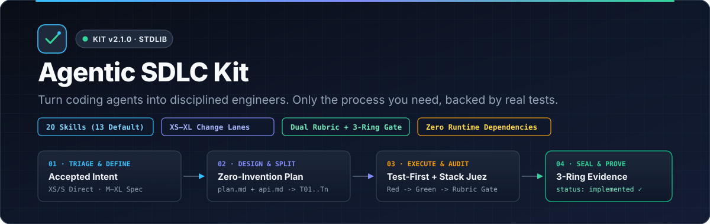
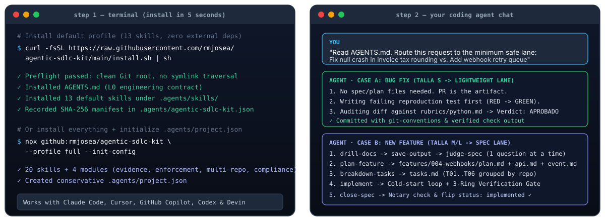
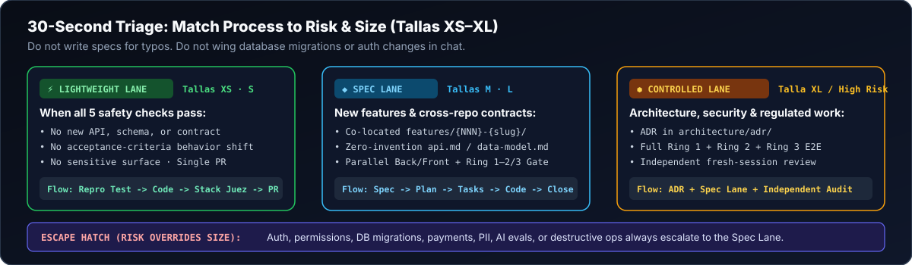
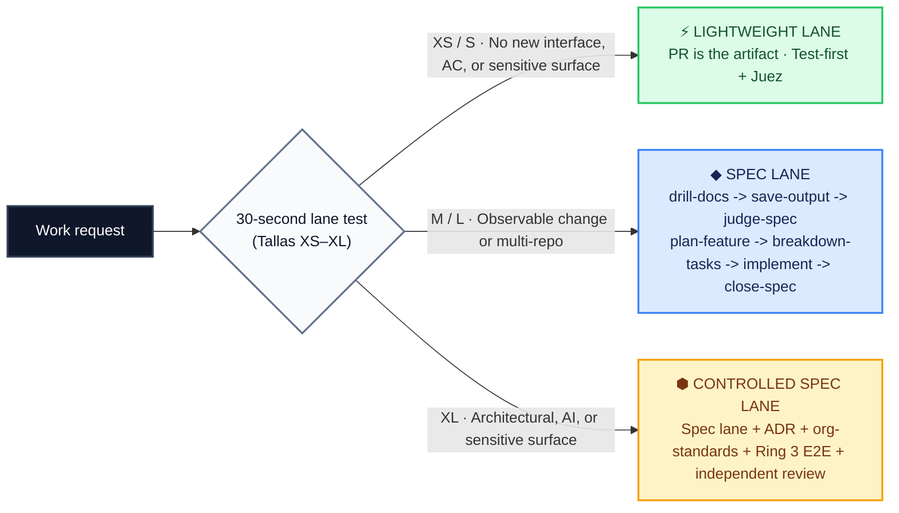
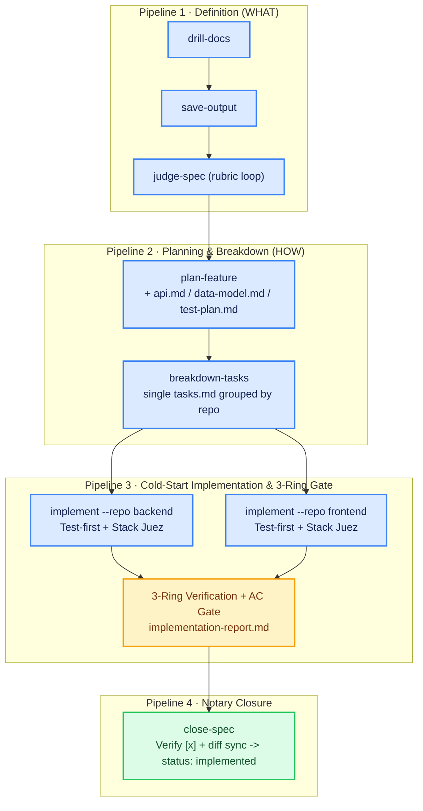
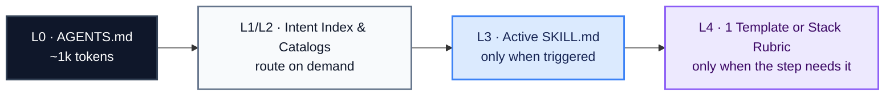

<div align="center">



<br />

[](LICENSE)
[](https://agentskills.io/)
[](#quick-start)
[](#portability)
[](#workflow-gates)
[](#quick-start)

**Give your coding agent a clear, practical way to move from an idea to tested, production-ready software — using only the process each change actually needs.**

[Quick Start](#quick-start) · [How to Use It](#how-to-use-it-in-your-daily-workflow) · [Change Lanes (XS–XL)](#choose-the-minimum-safe-path-tallas-xsxl--change-lanes) · [All 20 Skills](#workflow-gates) · [Architecture](#core-architectural-pillars) · [Full Developer Guide](docs/usage-guide.md)

</div>

---

## What is Agentic SDLC Kit?

Coding agents write code fast, but speed without structure creates drift: invented APIs, weakened tests, broken conventions, and context overload across long sessions. On the other hand, forcing a heavy specification pipeline onto a three-line bug fix slows you down for no reason.

**Agentic SDLC Kit** solves both problems. It installs directly into your repository as plain files — no external daemon, no SDK lock-in, no third-party dependencies, and zero telemetry — and gives your coding agent (Claude Code, Cursor, GitHub Copilot, Codex, Devin, or any `AGENTS.md`-compatible agent) a practical engineering harness:

- **A concise [`AGENTS.md`](AGENTS.md) L0 contract** (~1k tokens) that every session reads first so the agent thinks before editing, asks one clear question at a time with a recommended option, and never claims work is done without running real checks.
- **Twenty available [Agent Skills](https://agentskills.io/), with thirteen in the default profile**, loaded on demand so your context window stays clean.
- **Right-sized change lanes (XS–XL tallas)** under `.agents/conventions/` and `.agents/skills/`: take the **Lightweight lane** for direct bug fixes and small refactors, or the **Spec lane** when you are building features, changing contracts, or touching risky surfaces.
- **Dual quality rubrics and 3-Ring Verification**: 6 definition rubrics (`judge-spec`) to validate specs, stories, journeys, plans, and tasks before coding starts, plus 4 stack-specific *juez* rubrics (`python`, `node-ts`, `java`, `frontend`) that audit every code diff.
- **Optional governance modules** (`evidence`, `enforcement`, `multi-repo`, and `compliance`), included only when you install the `full` profile or select them explicitly.

<p align="center">
  
</p>

> [!IMPORTANT]
> **Composable gates, not bureaucracy.** You never have to run the full pipeline just to change code. Always use the lightest path that keeps your intent clear, your tests green, and your changes easy to recover.

---

## Quick start

You only need `git` and `python3` (standard library only). Run one command from the root of your target Git repository:

### 1. Install in one command

```bash
# Default profile (recommended to start): 13 core & utility skills, no modules
curl -fsSL https://raw.githubusercontent.com/rmjosea/agentic-sdlc-kit/main/install.sh | sh

# Full profile: all 20 skills + all 4 modules + a safe initial .agents/project.json
curl -fsSL https://raw.githubusercontent.com/rmjosea/agentic-sdlc-kit/main/install.sh | sh -s -- --profile full --init-config

# Prefer Node.js? Run the exact same installer via npx
npx github:rmjosea/agentic-sdlc-kit --profile default
```

### 2. Or clone locally and preview with `--dry-run`

If you want to inspect the repository first and see every file action before anything is written to disk:

```bash
git clone https://github.com/rmjosea/agentic-sdlc-kit.git
python3 agentic-sdlc-kit/scripts/install.py /path/to/your-repo --profile default --dry-run
python3 agentic-sdlc-kit/scripts/install.py /path/to/your-repo --profile default
python3 agentic-sdlc-kit/scripts/install.py /path/to/your-repo --with domain-model
```

> [!TIP]
> **Safe and transactional by design.** To pin a specific version in CI or team scripts, set `AGENTIC_SDLC_KIT_REF=<tag>` before `sh`. The installer never overwrites a custom `AGENTS.md` you already own (it exits with code `3` and lets you merge your rules cleanly) and rolls back automatically if interrupted.

### Installer options at a glance

| Option | What it installs / does |
| --- | --- |
| *(none)* or `--profile default` | Installs **13 default skills** (7 core + 6 utilities), `AGENTS.md`, and `.agents/conventions/`. |
| `--profile full` | Installs **all 20 skills** and **all 4 modules** (`evidence`, `enforcement`, `multi-repo`, `compliance`). |
| `--with <name>` | Adds any optional skill or module on top of your profile (selecting `compliance` automatically includes `evidence` and `enforcement`). |
| `--init-config` | Creates a conservative `.agents/project.json` if you do not have one yet, using only observed repository facts. |
| `--dry-run` | Prints every planned action (and the exact `.agents/project.json` when paired with `--init-config`) without touching disk. |

For deep details on profiles, conflict policies, and recovery, see [catalog and profiles](docs/usage-guide.md#catalog-and-profiles), [ownership and conflicts](docs/usage-guide.md#ownership-updates-and-conflicts), [optional initial configuration](docs/usage-guide.md#optional-initial-configuration), and [exit codes and recovery](docs/usage-guide.md#exit-codes-and-local-recovery-boundary).

---

## How to use it in your daily workflow

Once installed, open your project in your coding agent and talk to it in your normal language. By default, the kit follows a **two-tier language rule**: harness files (`AGENTS.md`, `.agents/**`) stay in English for token efficiency, while your product specs, stories, journeys, ADRs, and estimations are written in your project's business language (Spanish by default, or whatever you configure).

Here is how you actually use the kit depending on what you want to build today:

### Scenario 1 — You are not sure which workflow path to take (`ask-kit`)

Start your session with this prompt whenever you want the agent to inspect your request and pick the lightest safe route before touching any files:

```text
Read AGENTS.md. Do not modify files yet. Recommend the least durable safe
workflow gate for this request and explain why:

<describe your bug, refactor, or feature here>
```

### Scenario 2 — Fix a bug or make a small, focused change (`XS / S` · Lightweight Lane)

When you are fixing a localized bug, adjusting copy/config, or doing a bounded refactor that does not add new APIs, database tables, or acceptance criteria, **skip specs and plans completely**:

```text
Use implement on the Lightweight lane (Talla S) to fix this bug:
<describe the symptom and expected behavior>
Write the failing reproduction test first, apply the minimal fix, and run the stack juez rubric over the diff.
```

What the agent will do:
1. State `Intent`, `Change`, and `Verification` inline in chat.
2. Write or update a failing test that reproduces the issue (**RED**).
3. Write the minimal production code to make the test pass (**GREEN**).
4. Audit the diff against the matching stack rubric (`python`, `node-ts`, `java`, or `frontend`) and format the commit with `git-conventions`.

### Scenario 3 — Turn a rough idea into an approved specification (`M / L / XL` · Definition Pipeline)

When you are building new product behavior, do not let the agent guess requirements while coding. Run the **3-step Definition loop** in chat:

```text
1. Shape the idea in chat (one question at a time, with a recommended option):
   "Use drill-docs to help me define a spec for <your feature idea>."

2. Save the structured draft to disk with Shape A frontmatter:
   "Use save-output to materialize this spec."

3. Score and refine it against its quality rubric until ready:
   "Use judge-spec on features/001-<slug>/spec.md."
```

Once `judge-spec` scores the artifact above threshold (`>= 4.0/5.0` with no dimension `< 3`) and you confirm approval, the specification flips to `status: approved`.

### Scenario 4 — Plan, break down tasks, implement, and seal (`M / L / XL` · Implementation Pipeline)

With an approved spec on disk, move through technical design, task breakdown, and test-first execution:

```text
1. Create the technical plan and field-level contracts (api.md, data-model.md, event.md, test-plan.md):
   "Use plan-feature for features/001-<slug>/spec.md."

2. Turn the reviewed plan into atomic T01..Tn tasks grouped by repository:
   "Use breakdown-tasks for features/001-<slug>/plan.md."

3. Execute tasks (interactively or filtered by repo/task):
   "Use implement for features/001-<slug>/tasks.md."

4. Seal the specification once all tasks are [x] and verified:
   "Use close-spec for features/001-<slug>/spec.md."
```

### Scenario 5 — Multi-repo, selective loops, effort estimation & custom `AGENTS.md`

You can also run targeted commands for team and multi-repo workflows:

```text
# Execute only backend tasks or specific task IDs in a fresh session
Use implement for features/001-<slug>/tasks.md --repo backend
Use implement for features/001-<slug>/tasks.md --tasks T01,T02 --only-autonomous

# Estimate story points and sprints (optimistic vs. conservative) from a journey or spec
Use estimate-effort for features/001-<slug>/spec.md

# Audit or generate a tailored AGENTS.md for an existing repository
Use agents-creator to inspect this repository and propose a tailored AGENTS.md
```

---

## Choose the minimum safe path (Tallas XS–XL & Change Lanes)

<p align="center">
  
</p>



> [!WARNING]
> **Risk overrides size (Escape hatch).** Authentication, permissions, persistent-data semantics, database migrations, payments, privacy/PII, AI evaluations, destructive operations, difficult rollback, and unvetted dependency changes **never** use the Lightweight/direct path. If you start a small fix and discover it touches one of these surfaces, stop immediately and switch to the Spec lane.

| Tier / Path | Lane | Use when | Durable artifacts & verification net |
| --- | --- | --- | --- |
| **XS** *(Direct)* | **Lightweight** | Copy/i18n, config within policy, comments/docs, lint/format, patch bump | **The PR is the artifact**; state Intent, Change, and Verification inline |
| **S** *(Direct)* | **Lightweight** | Small bug fix or bounded refactor — no new interface or AC change | PR is the artifact + failing **reproduction test first** + stack **juez rubric** over diff |
| **M** *(Structured)* | **Spec** | Single-repo feature or observable functional change | Co-located `features/{NNN}-{slug}/`: `spec.md`, `plan.md` (+ companions), `tasks.md` |
| **L** *(Full)* | **Spec** | Multi-repo or complex feature with cross-service contracts | M artifacts + `target_repos`, parallel Front/Back via pinned `api.md`/`event.md`, Ring 1–3 checks |
| **XL** *(Controlled)* | **Spec** | Architectural change, high-risk AI, or regulated surface | L artifacts + ADR (`architecture/adr/`), org-standards triggers, independent review |

---

## Core architectural pillars

1. **Code as Source of Truth, Spec as Delta:** Executable code and passing tests in the base branch are the single authority for current system behavior. A specification (`spec`, `user-journey`, `user-story`) defines only the **approved delta** for the current change. Once sealed (`status: implemented`), committed tests carry the living behavioral contract and the specification remains a historical change record.
2. **Universal Context Discovery (Zero-Lock-in, 3 levels) & Search-First:** Works out of the box with any configured domain context or `vault/` layout (verifying paths against live code), standard repositories via `AGENTS.md` + manifests, and **3-cycle Iterative Retrieval** (stopping as soon as 3–5 files score `>= 0.7`). Enforces **Search-First (`Adopt -> Extend -> Compose -> Build`)** so agents reuse existing utilities and UI design-system components (**Zero Duplication**) before writing new helpers or proposing vetted external packages (`>= 7 days` old, `0 CVEs` in OSV.dev).
3. **Zero-Invention Companions & Parallel Front/Back Delivery:** Whenever a technical plan introduces a new persisted model, API endpoint, or event, `plan-feature` defines it field-by-field in `data-model.md`, `api.md`, `event.md`, and `test-plan.md` (including `data-testid` selectors). Because contracts are pinned upfront, Backend and Frontend repository groups execute **in parallel** without blocking or inventing payloads.
4. **Dual Rubric Gate & 3-Ring Verification:**
   - **6 Artifact Rubrics (`judge-spec`):** `rubric-spec`, `rubric-user-journey`, `rubric-user-story`, `rubric-adr`, `rubric-plan`, `rubric-tasks`.
   - **4 Stack Juez Rubrics (`implement`):** `python`, `node-ts` (Express / NestJS / TypeScript), `java` (Maven / Gradle / AEM / Spring), and `frontend` (Angular / TypeScript + WCAG 2.1/2.2 AA + i18n).
   - **3 Verification Rings:** **Ring 1** (Unit, Contract & Differential tests) -> **Ring 2** (Feature E2E over `data-testid`) -> **Ring 3** (Full-App E2E Regression for `L`/`XL` or shared surfaces).

---

## Workflow gates

```text
Definition:     drill-docs -> save-output -> judge-spec (loop)            -> approved artifact
Implementation: plan-feature -> breakdown-tasks -> implement -> close-spec -> implemented + validated change
```

Every skill lives under `.agents/skills/<name>/SKILL.md`. Thirteen are installed in the `default` profile; seven additional skills are available via `--profile full` or `--with <name>`:

| Skill | Responsibility | Writes |
| --- | --- | --- |
| `drill-docs` | Extract structure from unstructured input in chat, asking one question at a time | Nothing (chat draft) |
| `save-output` | Materialize a confirmed draft to disk with Shape A frontmatter and split past ~3000 tokens | `features/`, `journeys/`, `personas/`, `architecture/adr/` |
| `judge-spec` | Score and clarify a definition artifact against its `rubric-{type}.md` until `approved` | Surgical edits + status flip |
| `plan-feature` | Explore, interrogate, plan, and create field-level zero-invention companions (`data-model`, `api`, `event`, `test-plan`) | `features/{NNN}-{slug}/plan.md` + companions |
| `breakdown-tasks` | Decompose a reviewed plan into atomic `T01..Tn` tasks grouped by `repo` with `[A]/[I]/[*]` markers | `features/{NNN}-{slug}/tasks.md` |
| `implement` | Cold-start per-task gen-eval loop (test first -> minimal code -> stack juez rubric -> commit + `[x]`) + feature AC gate | Code, tests, `[x]`, `implementation-report.md` |
| `close-spec` | Notary closure: verify all tasks `[x]`, AC coverage, and diff sync; flip spec to `implemented` | `## Registro de implementación` in spec |
| `git-conventions` | Enforce Conventional Commits referencing task ID (`T0x`), branch naming, and pre-commit hooks | Nothing |
| `create-skill` | Author, improve, or evaluate portable skills via A/B/C interview and dogfood calibration | Skill files |
| `agents-creator` | Inspect a target repository and create or surgically improve its `AGENTS.md` | Target `AGENTS.md` after approval |
| `setup` | Configure or update project-owned kit settings and enabled modules | `.agents/project.json` |
| `ask-kit` | Recommend the minimum safe installed skill and workflow lane for a request | Nothing |
| `contribute` | Validate contribution policy, branch names, commit messages, and PR drafts | Nothing |
| `estimate-effort` *(optional)* | Estimate Story Points and sprints (optimistic/conservative) from S/M/L tallas | `estimaciones/{slug}/estimacion.md` |
| `domain-model` *(optional)* | Normalize domain language and record qualifying architectural decisions | `CONTEXT.md` or an ADR |
| `review` *(optional)* | Assess intent conformance and engineering quality on standalone diffs | Review report |
| `shape-idea` *(optional)* | Resolve early product ambiguity conversationally before writing files (classic v2 flow) | Nothing |
| `write-spec` *(optional)* | Persist **what** must be true as cohesive capability specs (classic v2 flow) | Configured specs root; fallback `specs/` |
| `plan` *(optional)* | Design **how** accepted intent will be implemented (classic v2 flow) | Configured work root; fallback `.work/` |
| `decompose-tasks` *(optional)* | Build the traceable dependency graph of tasks (classic v2 flow) | Tasks under the work root |

---

## Multi-session and selective loop execution

Long tasks degrade when crammed into one endless chat context. The kit hands work cleanly across fresh sessions through repository files (`tasks.md` checkboxes `[x]` + traceable Git commits), supporting both interactive IDE chats and selective autonomous runners (`--repo <id>`, `--tasks T01,T02`, `--only-autonomous`):



- **`tasks.md` is the single authority for task progress** (`[ ]` -> `[x]`); `handoff.md` is created only when you need an operational snapshot to pause or recover a blocked session.
- **Sequential within a repo, parallel across repos**: Inside a single repository, tasks execute sequentially on a standard Git branch (`git worktree` is optional only if you run concurrent autonomous agents on the same local checkout). Across repositories, Backend and Frontend task groups run in parallel against pinned contracts.
- **Honest review boundaries**: A review performed by the same session that wrote the code is always labeled a self-review — never an independent review.

---

## Progressive disclosure (L0–L4) & context hygiene

Instead of dumping thousands of lines of instructions into every prompt, the kit loads context in five strict tiers so the agent stays sharp and inference cost stays low:



---

## Why this works: research-backed rules

Every rule in [`AGENTS.md`](AGENTS.md) exists to prevent a documented failure mode in coding agents:

| Observed agent failure mode | Research source | How Agentic SDLC Kit prevents it |
| --- | --- | --- |
| Bloated repository context files add >20% inference cost without improving task success when packed with static overviews. | Gloaguen et al., ICLR 2026 ([arXiv:2602.11988](https://arxiv.org/abs/2602.11988)) | `AGENTS.md` is strictly capped by automated tests and contains only actionable rules and intent routing. |
| Instruction-following accuracy drops as simultaneous instructions pile up. | IFScale ([arXiv:2507.11538](https://arxiv.org/abs/2507.11538)) | Progressive disclosure (L0–L4): load metadata first, then one active `SKILL.md`, then only the single template or rubric needed right now. |
| Agents that jump straight to editing without inspecting dependencies or validating results fail significantly more often (across 9,374 trajectories). | [arXiv:2604.02547](https://arxiv.org/abs/2604.02547) | **Think before editing** and **Execution-grounded truth**: agents must inspect code first and run real checks before claiming completion. |
| Agents get stuck in repetitive edit-fail loops caused by cognitive lock-in to a wrong hypothesis. | [arXiv:2509.13941](https://arxiv.org/abs/2509.13941) | **Circuit breaker**: if a fix fails twice in a row, the agent must stop editing, inspect runtime state, and explain why the previous hypothesis failed. |
| Coding agents over-mock internal logic in tests (36% vs. 26% in human commits) or weaken assertions just to get a green build. | [arXiv:2602.00409](https://arxiv.org/abs/2602.00409) | **Test preservation & Stack Juez**: mock only external I/O, assert observable behavior, and never delete or weaken existing tests. |
| AI increases code output but causes instability unless paired with small batches and fast automated feedback. | [DORA 2025](https://dora.dev/research/2025/dora-report) | Atomic `T01..Tn` tasks, test-first execution, risk-proportionate verification rings, and independent review for high-risk changes. |
| Perceived AI speed-ups often diverge from measured real-world delivery speed. | [METR, 2025–2026](https://metr.org/blog/2026-02-24-uplift-update/) | No unverified marketing claims. Measure real impact on your own tasks with the [baseline evaluation protocol](docs/usage-guide.md#18-baseline-evaluation-protocol). |

---

## Behavior rules every session follows

Every skill and message is governed by the core engineering contract in [`AGENTS.md`](AGENTS.md):

- **Think before editing:** Inspect relevant code, trace dependencies, and form a clear mental model before changing files.
- **Surgical simplicity & minimal diff:** Solve the accepted need with the simplest code; fix root causes rather than adding workarounds; never refactor unrelated files.
- **Execution-grounded truth:** Define observable success upfront, run the actual checks, and report real output. Never claim completion when checks fail or were not run.
- **Circuit breaker:** After two consecutive failed fix attempts, stop editing and inspect runtime state before trying a third time.
- **Test preservation:** Never delete, comment out, skip, or weaken an existing test to make a check pass.
- **Human decision protocol (always a recommendation):** Whenever a material requirement or technical choice is ambiguous, ask **one self-contained question at a time**, offer **2–4 distinct options with trade-offs**, mark **one option as Recommended** with evidence, and allow a free-form answer.

---

## Evidence and optional modules

Modules stay completely inactive unless they are both **installed** and **enabled** in `.agents/project.json` (via `setup` or `--init-config`):

| Module | What it adds when enabled |
| --- | --- |
| `evidence` | Produces a schema-validated `evidence.json` and linked `review.md` for changes that require durable proof. |
| `enforcement` | Provides a deterministic, read-only consistency checker (`.agents/modules/enforcement/check.py`) for kit artifacts and configuration. |
| `multi-repo` | Coordinates changes across existing local Git checkouts; never clones, fetches, pushes, or touches credentials. |
| `compliance` | Maintains a schema-valid `audit.jsonl` and declared approval rules in Git (an editable repository-versioned audit trail, not a cryptographic signature or legal certification). |

Run the read-only consistency checker at any time when `enforcement` is installed:

```bash
python3 .agents/modules/enforcement/check.py --root . --format human
```

---

## Repository structure

```text
.
├── AGENTS.md                  # Concise L0 engineering contract read by every session
├── install.sh                 # One-command POSIX installer (curl | sh or local)
├── bin/cli.js                 # Node.js / npx launcher for the same installer
├── .agents/
│   ├── kit-catalog.json       # Source of truth: 20 skills (13 default, 7 optional), 4 modules, profiles
│   ├── artifact-catalog.json  # Declarative artifact owners, templates, schemas, and split rules
│   ├── conventions/           # On-demand conventions (XS–XL lanes, Shapes A/B/C, recipes, security)
│   ├── indexes/by-intent.md   # Fast intent-to-skill routing index
│   ├── schemas/               # Closed JSON Schema 2020-12 contracts
│   ├── skills/                # 20 portable Agent Skills + templates + artifact & stack juez rubrics
│   ├── modules/               # Optional governance modules: evidence · enforcement · multi-repo · compliance
│   └── tools/                 # Deterministic CLI tools:
│       ├── context_search.py        # 3-cycle Vault & Code symbol/line-window search (0 LLM tokens)
│       ├── check_companions.py      # Zero-Invention contract (api/event/data-model/data-testid) verifier
│       ├── ralph-loop.sh            # Clean-context per-task execution loop (--repo, --tasks, [A]/[I]/[*])
│       ├── metrics_report.py        # Execution telemetry & Pass@1 / ACU benchmark reporter
│       ├── fingerprint_artifact.py  # Canonical SHA-256 artifact & REQ/AC fingerprinting
│       └── check_artifact_ids.py    # Historical & current artifact ID uniqueness scanner
├── docs/
│   ├── assets/                # Visual architecture and quickstart SVG diagrams
│   └── usage-guide.md         # Step-by-step developer manual with 5 worked examples & prompt cheat sheet
├── scripts/
│   ├── install.py             # Transactional installer with SHA-256 ownership manifest & rollback
│   └── validate.py            # Distribution, link, contract, and Shape A/B/C validator
└── tests/                     # 515+ automated unit tests and behavioral evaluation scenarios
```

---

## Portability

All skills follow the open [Agent Skills specification](https://agentskills.io/specification), and [`AGENTS.md`](AGENTS.md) is the single entrypoint contract. The kit works out of the box with coding agents that read `AGENTS.md` and `.agents/skills/`, including **Claude Code**, **Cursor**, **GitHub Copilot**, **Codex**, and **Devin**. If your tool looks for skills in a custom folder, simply point it to `.agents/skills/` — there is one canonical source for every skill and zero provider-specific lock-in.

---

## Validate

If you are working in a clone of this kit repository, run the validator and full test suite with zero external packages:

```bash
# Validate catalog, skill budgets, links, contracts, and Shape A/B/C schemas
python3 scripts/validate.py

# Run all 515+ unit and integration tests
python3 -m unittest discover -s tests

# In any target repository where the enforcement module is installed
python3 .agents/modules/enforcement/check.py --root . --format human
python3 .agents/modules/enforcement/check.py --root . --format json
```

Behavioral evaluation scenarios are documented in [`tests/scenarios.md`](tests/scenarios.md).

---

## Documentation

- [**Developer Guide (`docs/usage-guide.md`)**](docs/usage-guide.md): Full operating manual, installation contracts, 5 end-to-end worked examples, parallel execution, recovery handoffs, and a copy-paste prompt cheat sheet.
- [**Engineering Contract (`AGENTS.md`)**](AGENTS.md): The L0 contract installed into target repositories.
- [**Evaluation Scenarios (`tests/scenarios.md`)**](tests/scenarios.md): Behavioral and regression scenarios used to verify kit discipline.

## License

Released under the [MIT License](LICENSE).
