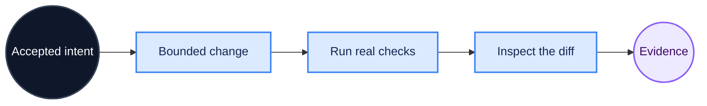
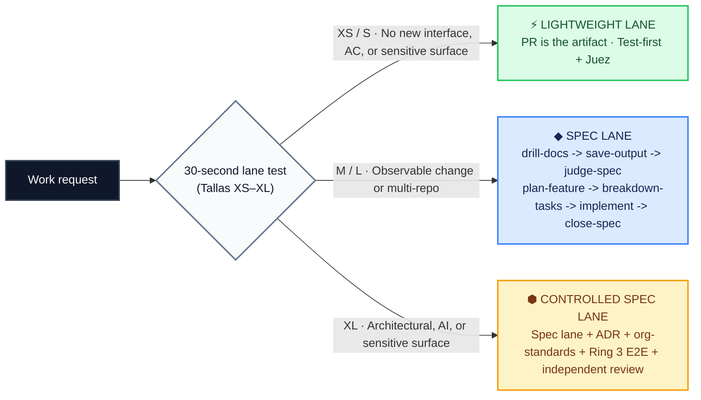
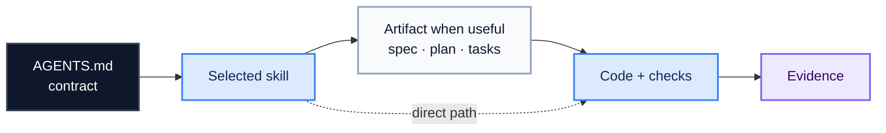
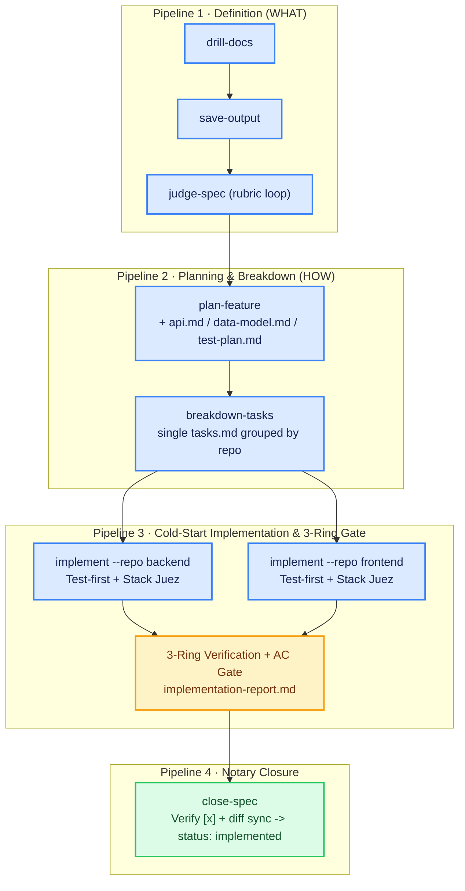
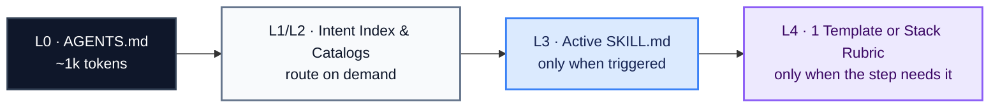

# Agentic SDLC Kit

**A small, evidence-driven engineering harness that keeps coding agents aligned with your intent, your repository, and your tests.**

[](LICENSE)
[](https://agentskills.io/)
[](#quick-start)
[](#portability)
[](#workflow-gates)
[](#quick-start)

Agentic SDLC Kit gives any coding agent a disciplined path from accepted intent
to verified software, without forcing heavyweight process onto small changes.
It is plain files in your repository: no framework, no service, no telemetry.

It combines:

- a concise [`AGENTS.md`](AGENTS.md) engineering contract that every session reads;
- twenty available [Agent Skills](https://agentskills.io/), with thirteen in the default profile;
- optional `evidence`, `enforcement`, `multi-repo`, and `compliance` modules, included only by the full profile or explicit selection;
- SOA-aligned change lanes (XS–XL tallas: Lightweight lane vs Spec lane), Shape A/B/C frontmatter, zero-invention companions, and per-stack juez rubrics under `.agents/conventions/` and `.agents/skills/`;
- explicit human decisions, always with one recommended option;
- observable evidence before any completion claim.

> [!IMPORTANT]
> The workflow is a set of composable gates, not a mandatory pipeline. Use the
> least durable process that safely preserves intent, evidence, and
> recoverability.

## Quick start

Run one command from the root of your Git repository. You need `python3`
(standard library only) and `git`.

```bash
# Default profile: 13 skills, no modules
curl -fsSL https://raw.githubusercontent.com/rmjosea/agentic-sdlc-kit/main/install.sh | sh

# Full profile, plus a conservative .agents/project.json for this repository
curl -fsSL https://raw.githubusercontent.com/rmjosea/agentic-sdlc-kit/main/install.sh | sh -s -- --profile full --init-config

# Same installer through Node.js
npx github:rmjosea/agentic-sdlc-kit --profile default
```

Prefer to read before you run? Clone the kit and preview without writing:

```bash
git clone https://github.com/rmjosea/agentic-sdlc-kit.git
python3 agentic-sdlc-kit/scripts/install.py /path/to/repository --profile default --dry-run
python3 agentic-sdlc-kit/scripts/install.py /path/to/repository --with domain-model
```

> [!TIP]
> For reproducible installs, pin a release: `AGENTIC_SDLC_KIT_REF=<tag>` before
> `sh`. The installer is transactional, never overwrites a project-owned
> `AGENTS.md` (it asks for a manual merge instead), and stops on conflicts.

What the installer does:

| Option | Effect |
| --- | --- |
| *(none)* | Default profile: thirteen skills and no modules. |
| `--profile full` | All twenty skills and all four modules. |
| `--with <name>` | Adds a skill or module; `compliance` also selects `evidence` and `enforcement`. |
| `--init-config` | Creates `.agents/project.json` only if absent, from safe defaults plus observed facts. |
| `--dry-run` | Shows every action, and the exact config with `--init-config`, without writing. |

Details: [catalog and profiles](docs/usage-guide.md#catalog-and-profiles),
[ownership and conflicts](docs/usage-guide.md#ownership-updates-and-conflicts),
[optional initial configuration](docs/usage-guide.md#optional-initial-configuration),
and [exit codes and recovery](docs/usage-guide.md#exit-codes-and-local-recovery-boundary).

Then ask your agent:

```text
Read AGENTS.md. Do not modify files yet. Recommend the least durable safe
workflow gate for this request and explain why:

<your request>
```

## Why this exists

Coding agents write code quickly. The hard part is keeping them aligned with
product intent, repository conventions, risk, and real test results across
sessions. The kit closes that loop:



## What the research says, and what the kit does about it

Every rule in the kit has a named failure behind it. These are the main sources.

| Finding | Source | How the kit responds |
| --- | --- | --- |
| Repository context files do not generally raise task success and add over 20% inference cost; agents do follow their instructions, so unnecessary requirements make tasks harder. | Gloaguen et al., ICLR 2026 ([arXiv:2602.11988](https://arxiv.org/abs/2602.11988)) | `AGENTS.md` holds only minimal, actionable rules and no repository overview; a test caps its length. Detail lives in skills loaded on demand. |
| Instruction-following degrades as the number of simultaneous instructions grows. | IFScale ([arXiv:2507.11538](https://arxiv.org/abs/2507.11538)) | Three-level progressive disclosure: metadata, then one `SKILL.md`, then only its needed references. |
| Across 9,374 trajectories, agents that gather context before editing and invest in validation succeed more often. | [arXiv:2604.02547](https://arxiv.org/abs/2604.02547) | "Think before editing" and execution-grounded verification are core rules; completion requires observed check results. |
| Most agentic failures come from flawed reasoning and cognitive deadlocks. | [arXiv:2509.13941](https://arxiv.org/abs/2509.13941) | Circuit breaker: after two failed fixes, stop editing, observe runtime state, and state why the old hypothesis was wrong. |
| Coding agents add mocks to tests more often than other contributors (36% vs 26% of commits). | [arXiv:2602.00409](https://arxiv.org/abs/2602.00409) | Mock only external I/O; assert observable output; never delete or weaken an existing test to get green. |
| AI amplifies existing practice: more throughput, but more instability without small batches, strong automated tests, and fast feedback. | [DORA 2025](https://dora.dev/research/2025/dora-report) | Small bounded changes, risk-proportionate evidence, and independent review for high risk. |
| Developers' perceived speed-up can differ sharply from measured speed. | [METR, 2025-2026](https://metr.org/blog/2026-02-24-uplift-update/) | The kit claims no speed or quality gain by itself. Measure it in your own repository with the [baseline evaluation protocol](docs/usage-guide.md#18-baseline-evaluation-protocol). |

> [!NOTE]
> No harness can guarantee better code. The kit removes known failure modes and
> makes every claim checkable; whether it helps your team is something to
> measure, not assume.

## Choose the minimum safe path (Tallas XS–XL & Change Lanes)



> [!WARNING]
> **Risk overrides size (Escape hatch).** Authentication, permissions, persistent-data
> semantics, migrations, payments, privacy/PII, AI evaluations, destructive effects,
> difficult rollback, and unclassified dependency changes never use the Lightweight/direct path.
> If discovered mid-change, stop immediately and switch to the Spec lane.

| Tier / Path | Lane | Use when | Durable artifacts & verification net |
| --- | --- | --- | --- |
| **XS** *(Direct)* | **Lightweight** | Copy/i18n, config within policy, comments/docs, lint/format, patch bump | **The PR is the artifact**; state Intent, Change, Verification inline |
| **S** *(Direct)* | **Lightweight** | Small bug-fix or bounded refactor — no new interface or AC change | PR is the artifact + failing **reproduction test first** + stack **juez rubric** over diff |
| **M** *(Structured)* | **Spec** | Single-repo feature or observable functional change | Co-located `features/{NNN}-{slug}/`: `spec.md`, `plan.md` (+ companions), `tasks.md` |
| **L** *(Full)* | **Spec** | Multi-repo or complex feature with cross-service contracts | M artifacts + `target_repos`, parallel Front/Back via pinned `api.md`/`event.md`, Ring 1–3 checks |
| **XL** *(Controlled)* | **Spec** | Architectural change, high-risk AI, or regulated surface | L artifacts + ADR (`architecture/adr/`), org-standards triggers, independent review |

## Core architectural pillars

1. **Code as Source of Truth, Spec as Delta:** Executable code and passing tests in the base branch are the single authority for current system behavior. A specification (`spec`, `user-journey`, `user-story`) defines only the **approved delta** for the current change. Once sealed (`status: implemented`), committed tests remain the living regression guard.
2. **Universal Context Discovery (Zero-Lock-in, 3 levels) & Search-First:** Works out of the box with any configured domain context or `vault/` layout (verifying paths against live code), standard repositories via `AGENTS.md` + manifests, and **3-cycle Iterative Retrieval** (stopping at 3–5 files scoring `>= 0.7`). Enforces **Search-First (`Adopt -> Extend -> Compose -> Build`)** to reuse existing utilities and UI design-system components (**Zero Duplication**) before proposing new code or vetted external packages (`>= 7 days` old, `0 CVEs` in OSV.dev).
3. **Zero-Invention Companions & Parallel Front/Back Delivery:** Whenever a plan introduces a new persisted model, API endpoint, or event, `plan-feature` defines it field-by-field in `data-model.md`, `api.md`, `event.md`, and `test-plan.md` (including `data-testid` selectors). Because contracts are pinned upfront, Backend and Frontend repository groups execute **in parallel** without blocking each other.
4. **Dual Rubric Gate & 3-Ring Verification:**
   - **6 Artifact Rubrics (`judge-spec`):** `rubric-spec`, `rubric-user-journey`, `rubric-user-story`, `rubric-adr`, `rubric-plan`, `rubric-tasks`.
   - **4 Stack Juez Rubrics (`implement`):** `python`, `node-ts` (Express / NestJS / TypeScript), `java` (Maven / Gradle / AEM / Spring), and `frontend` (Angular / TypeScript + WCAG 2.1/2.2 AA + i18n).
   - **3 Verification Rings:** **Ring 1** (Unit, Contract & Differential tests) -> **Ring 2** (Feature E2E over `data-testid`) -> **Ring 3** (Full-App E2E Regression for `L`/`XL` or shared surfaces).

## Workflow gates

```text
Definition:     drill-docs -> save-output -> judge-spec (loop)            -> approved artifact
Implementation: plan-feature -> breakdown-tasks -> implement -> close-spec -> implemented + validated change
```

| Skill | Responsibility | Writes |
| --- | --- | --- |
| `drill-docs` | Extract structure from unstructured input, one question at a time | Nothing (chat draft) |
| `save-output` | Materialize a draft with Shape A frontmatter and split when >~3000 tokens | `features/`, `journeys/`, `personas/`, `architecture/adr/` |
| `judge-spec` | Score and clarify a definition artifact against its `rubric-{type}.md` until `approved` | Surgical edits + status flip |
| `plan-feature` | Explore, interrogate, plan, and create field-level zero-invention companions (`data-model`, `api`, `event`, `test-plan`) | `features/{NNN}-{slug}/plan.md` + companions |
| `breakdown-tasks` | Decompose a reviewed plan into atomic `T01..Tn` tasks grouped by `repo` with `[A]/[I]/[*]` markers | `features/{NNN}-{slug}/tasks.md` |
| `implement` | Cold-start per-task gen-eval loop (test first -> minimal code -> stack juez rubric -> commit + `[x]`) + feature AC gate | Code, tests, `[x]`, `implementation-report.md` |
| `close-spec` | Notary: verify all tasks `[x]`, AC coverage, and diff sync; flip spec to `implemented` | `## Registro de implementación` in spec |
| `git-conventions` | Enforce Conventional Commits referencing task ID (`T0x`), branch naming, and pre-commit hooks | Nothing |
| `create-skill` | Extend or improve portable skills via A/B/C interview and dogfood calibration | Skill files |
| `agents-creator` | Inspect a target repository and create or surgically improve its `AGENTS.md` | Target `AGENTS.md` after approval |
| `setup` | Configure project-specific kit settings | `.agents/project.json` |
| `ask-kit` | Recommend the minimum safe installed route | Nothing |
| `contribute` | Check contribution policy, branch names, commit messages, and PR drafts | Nothing |
| `estimate-effort` *(optional)* | Estimate Story Points and sprints (optimistic/conservative) from S/M/L tallas | `estimaciones/{slug}/estimacion.md` |
| `domain-model` *(optional)* | Normalize domain language and record qualifying decisions | `CONTEXT.md` or an ADR |
| `review` *(optional)* | Assess intent conformance and engineering quality on standalone diffs | Review report |
| `shape-idea` *(optional)* | Resolve material product ambiguity conversationally (classic flow) | Nothing |
| `write-spec` *(optional)* | Preserve **what** must be true (classic v2 flow) | Configured specs root; fallback `specs/` |
| `plan` *(optional)* | Decide **how** intent will be implemented (classic v2 flow) | Configured work root; fallback `.work/` |
| `decompose-tasks` *(optional)* | Build the dependency graph of tasks (classic v2 flow) | Tasks under the work root |



## Behavior rules every session follows

These live in [`AGENTS.md`](AGENTS.md) and apply to every skill and message:

- **Think before editing.** Inspect code and trace dependencies first.
- **Simplest sufficient change.** Surgical diffs, no speculative extensibility, root causes over workarounds.
- **Execution-grounded truth.** Define observable success first; never claim completion with failing or unrun checks.
- **Self-critique.** Check failure paths and edge cases before calling work done.
- **Circuit breaker.** After two failed fixes, stop and inspect runtime state before a third attempt.
- **Test preservation.** Never delete, skip, or weaken an existing test to get green.
- **Comments explain why, not what.** Follow the repository's or the ecosystem's documentation convention.
- **Clear, unambiguous language.** Self-contained questions with context, decision, and consequences.
- **Always a recommendation.** Two to four options, each with its trade-off, exactly one marked **Recommended** with evidence, and room for a free-form answer.

Commit discipline (atomic, imperative subject, body explains why) is applied by
the `contribute` skill when you prepare a commit.

## Multi-session and selective loop execution

Long tasks degrade inside one ever-growing session. The kit hands work across
fresh sessions through repository files (`tasks.md` checkboxes `[x]` + Git commits),
supporting both interactive IDE execution and selective autonomous loop runners
(`--repo <id>`, `--tasks T01,T02`, `--only-autonomous`):



- `tasks.md` is the single authority for task state (`[ ]` -> `[x]`); `handoff.md` is an operational recovery snapshot.
- Within a repository, tasks run sequentially on a standard Git branch (`git worktree` is optional only when running concurrent autonomous agents on the same local checkout). Across repositories, Backend and Frontend groups can run in parallel.
- A review by the implementer is a self-review and is never presented as independent.

## Progressive disclosure (L0–L4)



Specs, plans, conventions, rubrics, and source files are never preloaded wholesale.

## Evidence and optional modules

Modules are inactive until installed **and** enabled in `.agents/project.json`
(by `setup` or `--init-config`):

| Module | What it adds |
| --- | --- |
| `evidence` | A structured `evidence.json` and linked `review.md` for changes that warrant durable proof. |
| `enforcement` | A deterministic, read-only consistency checker for kit artifacts. |
| `multi-repo` | Coordination across existing local checkouts; never clones, pushes, or uses credentials. |
| `compliance` | A schema-valid `audit.jsonl` and declared approval rules. It is an editable, versioned record, not a cryptographic chain, identity proof, or legal certification. |

```bash
python3 .agents/modules/enforcement/check.py --root . --format human
```

## Repository structure

```text
.
├── AGENTS.md                  # Concise L0 engineering contract read by every session
├── install.sh                 # One-command installer (curl | sh or local)
├── bin/cli.js                 # Same installer through npx
├── .agents/
│   ├── kit-catalog.json       # 20 skills (13 default, 7 optional), 4 modules, and profiles
│   ├── artifact-catalog.json  # Declarative artifact owners, templates, schemas, and split rules
│   ├── conventions/           # 13 on-demand conventions (lanes XS–XL, Shapes A/B/C, recipes, security)
│   ├── indexes/by-intent.md   # Non-authoritative intent router
│   ├── schemas/               # Closed JSON Schema 2020-12 contracts
│   ├── skills/                # 20 portable Agent Skills + templates + artifact & stack juez rubrics
│   ├── modules/               # evidence · enforcement · multi-repo · compliance
│   └── tools/                 # Deterministic ID and SHA-256 fingerprint helpers
├── docs/usage-guide.md        # Complete developer guide with worked examples
├── scripts/
│   ├── install.py             # Transactional installer with rollback guarantees
│   └── validate.py            # Source distribution & Shape A/B/C validator
└── tests/                     # 515+ unit tests and behavioral evaluation scenarios
```

## Portability

Skills follow the open [Agent Skills specification](https://agentskills.io/specification),
and `AGENTS.md` is the single engineering contract. The kit is built for agents
that read `AGENTS.md`, such as Codex, Claude Code, Cursor, and GitHub Copilot.
If a tool does not discover `.agents/skills/` automatically, point it there.
There is one canonical source for every skill and no provider-specific copies.

## Validate

```bash
# In this source checkout: distribution, links, contracts, and budgets
python3 scripts/validate.py
python3 -m unittest discover -s tests

# In a repository where enforcement is installed
python3 .agents/modules/enforcement/check.py --root . --format human
python3 .agents/modules/enforcement/check.py --root . --format json
```

Behavioral scenarios for forward evaluation are in
[`tests/scenarios.md`](tests/scenarios.md).

## Documentation

- [Developer Guide](docs/usage-guide.md): complete prompts, examples, task states, parallel work, and recovery.
- [`AGENTS.md`](AGENTS.md): the installed engineering contract.
- [`tests/scenarios.md`](tests/scenarios.md): quality and regression scenarios.

## Project principles

- Define the problem before designing the solution.
- Keep **what**, **how**, execution order, and evidence separate.
- Use durable artifacts only when they improve alignment or recovery.
- Prefer vertical, independently verifiable outcomes.
- Increase rigor with risk, not with diff size.
- Never claim success without evidence.

## License

Released under the [MIT License](LICENSE).
