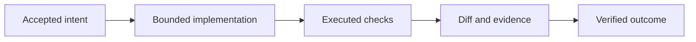
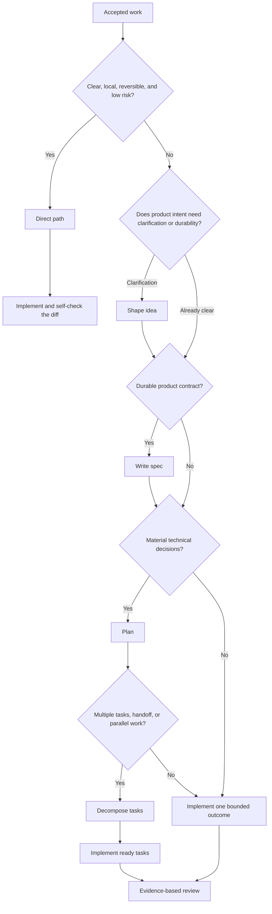
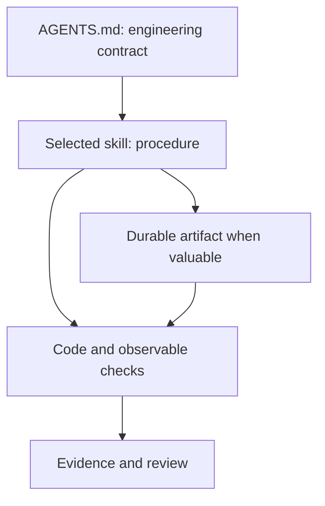
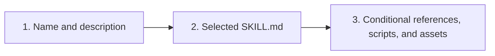

# Agentic SDLC Kit

**A lightweight, evidence-driven development harness for coding agents.**

[](LICENSE)
[](https://agentskills.io/)
[](#portability)
[](#workflow-gates)

Agentic SDLC Kit gives coding agents a disciplined path from accepted intent to
verified software—without forcing heavyweight process onto small changes.

It combines:

- a concise [`AGENTS.md`](AGENTS.md) engineering contract;
- seven composable [Agent Skills](https://agentskills.io/);
- durable specs, plans, task graphs, and handoffs only when they add value;
- explicit human decisions for material ambiguity;
- observable evidence before completion claims.

> [!IMPORTANT]
> The workflow is a set of composable gates, not a mandatory pipeline. Use the
> least durable process that safely preserves intent, evidence, and
> recoverability.

## Why this exists

Coding agents can generate code quickly. The harder problem is keeping them
aligned with product intent, repository conventions, risk, and observable
quality across multiple sessions.

This kit provides the missing control loop:



It is deliberately small: no orchestration framework, provider adapter layer,
mandatory issue format, or speculative automation.

## Choose the minimum safe path



Risk overrides apparent size. Authentication, permissions, persistent-data
semantics, migrations, payments, privacy, destructive effects, difficult
rollback, and unclassified dependency changes cannot use the direct path.

### Path overview

| Path | Use when | Durable artifacts |
| --- | --- | --- |
| **Direct** | Clear, local, reversible, low-risk change | None |
| **Spec-only** | Durable behavior; standard implementation | `spec.md` |
| **Plan-only** | Accepted intent; non-obvious design | `plan.md` |
| **Full** | Durable behavior, design, and multiple tasks | Spec, plan, tasks |
| **Controlled** | Elevated risk or recovery needs | Intent, plan, evidence |

## Workflow gates

```text
idea -> shape-idea -> write-spec -> plan -> decompose-tasks -> implement -> review
```

| Skill | Responsibility | Writes |
| --- | --- | --- |
| `shape-idea` | Resolve material product ambiguity | Nothing |
| `write-spec` | Preserve **what** must be true | `specs/` |
| `plan` | Decide **how** intent will be implemented | `.work/<feature>/` |
| `decompose-tasks` | Build the execution graph | `tasks.md` |
| `implement` | Deliver one bounded outcome | Code and evidence |
| `review` | Assess intent and engineering quality | Review report |
| `create-skill` | Extend the portable skill set | Skill files |

The separation is intentional:



## Quick start

### 1. Install

Clone this repository, then run the installer from the kit directory:

```bash
python3 scripts/install.py /path/to/your/repository --dry-run
python3 scripts/install.py /path/to/your/repository
```

The installer:

- copies the seven canonical skills into `.agents/skills/`;
- installs `AGENTS.md` when the target does not have one;
- never replaces conflicting skills without `--force-skills`;
- preserves an existing `AGENTS.md` for manual semantic merging.

Exit code `3` means the skills were installed but the existing `AGENTS.md`
still needs a manual merge.

### 2. Ask the agent to select a route

```text
Read AGENTS.md and the relevant repository guidance. Do not modify files yet.
Recommend the least durable safe workflow gate for this request and explain
why:

<your request>
```

### 3. Invoke the selected skill

Direct low-risk change:

```text
Use implement only if every direct-path condition in AGENTS.md holds. State
Intent, Change, and Verification inline, make the smallest coherent change,
run proportionate checks, and self-check the final diff. Do not create durable
workflow artifacts.
```

Full feature:

```text
Use shape-idea to clarify this feature one material decision at a time. Write
no files until the shared understanding is approved.
```

An approved spec or plan with one bounded outcome can go directly to
`implement`; do not create a one-node task graph.

> [!TIP]
> The [Developer Guide](docs/usage-guide.md) contains complete prompts,
> step-by-step examples, task-state diagrams, parallel-work rules, handoff
> guidance, and common failure modes.

## Progressive disclosure

The kit protects agent context through three layers:



- Skill metadata is available for discovery.
- A `SKILL.md` loads only when its workflow is relevant.
- Supporting resources load only under conditions declared by that skill.
- Specs, plans, references, and source files are never loaded wholesale.

## Human control

Material decisions remain explicit:

1. Ask one clear, self-contained question at a time.
2. Offer genuinely distinct alternatives when useful.
3. Explain the principal consequence of each option.
4. Mark and justify one recommendation.
5. Preserve a free-form choice.
6. Never interpret silence as approval.

Agents decide trivial, reversible, repository-standard details directly and
record the rationale instead of interrupting the user.

## Evidence and recovery

The harness supports only claims backed by observable results:

- task completion requires actual validation evidence;
- failing or unrun required checks cannot support `done`;
- changes to intent or design invalidate affected artifacts;
- `tasks.md` remains authoritative for task state;
- `handoff.md` is a recovery snapshot, not a second source of truth;
- high-risk approval requires an independent review.

Markdown task state is not an atomic lock. A human or external orchestrator must
assign parallel tasks before subagents start.

## Repository structure

```text
.
├── AGENTS.md
├── .agents/
│   └── skills/
│       ├── shape-idea/
│       ├── write-spec/
│       ├── plan/
│       ├── decompose-tasks/
│       ├── implement/
│       ├── review/
│       └── create-skill/
├── docs/
│   └── usage-guide.md
├── scripts/
│   ├── install.py
│   └── validate.py
└── tests/
    └── scenarios.md
```

## Portability

The canonical instructions use the open Agent Skills format and avoid
provider-specific behavior. `AGENTS.md` is the repository engineering contract.

The kit is designed for coding environments such as Codex, Claude Code, Cursor,
GitHub Copilot, and other agentic tools. Skill discovery locations still vary
between products, so configure the tool to read `AGENTS.md` and discover
`.agents/skills/` when it does not do so automatically.

The project intentionally avoids duplicated provider adapters. There is one
canonical source for every skill.

## Validate

Run the structural validator:

```bash
python3 scripts/validate.py
```

It checks:

- expected skill set and directory names;
- Agent Skill metadata;
- size and progressive-disclosure budgets;
- local references and templates;
- required spec, plan, and task fields;
- provider neutrality.

Behavioral forward-evaluation scenarios live in
[`tests/scenarios.md`](tests/scenarios.md).

## Documentation

- [Developer Guide](docs/usage-guide.md) — complete operating manual.
- [`AGENTS.md`](AGENTS.md) — canonical engineering contract.
- [`tests/scenarios.md`](tests/scenarios.md) — quality and regression scenarios.

## Project principles

- Define the problem before designing the solution.
- Preserve **what**, **how**, execution order, and evidence as separate concerns.
- Use durable artifacts only when they improve alignment or recovery.
- Prefer vertical, independently verifiable outcomes.
- Increase rigor with risk, not with diff size.
- Make surgical changes and avoid speculative abstraction.
- Never claim success without evidence.

## License

Released under the [MIT License](LICENSE).
