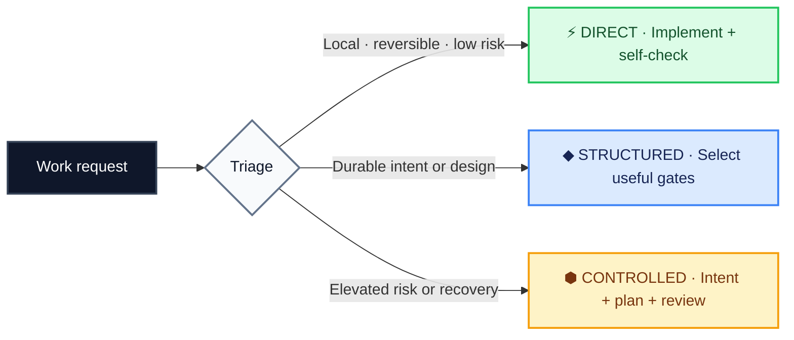
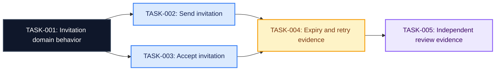
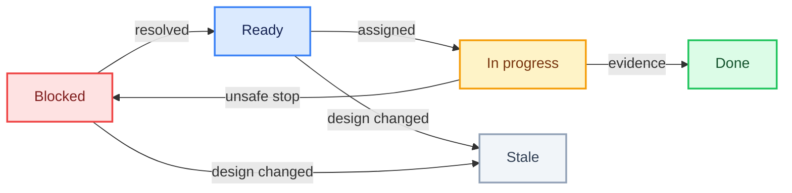
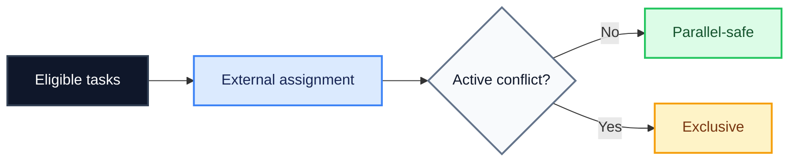
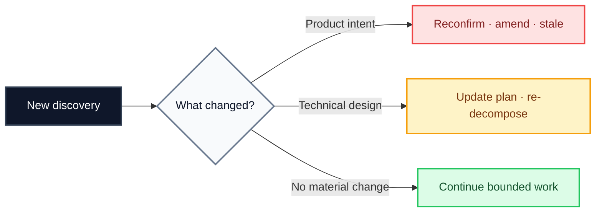

# Agentic SDLC Kit: Developer Guide

**A practical operating manual from first request to verified software.**

[](#1-the-operating-model)
[](#5-example-a-direct-typo-fix)
[](#3-prepare-the-coding-agent)

This guide explains how to develop software with Agentic SDLC Kit using any
compatible coding agent, including Codex, Claude Code, Cursor, GitHub Copilot,
or another tool that can read repository instructions and Agent Skills.

The kit is a decision and verification harness. It does not replace your coding
agent, programming language, test framework, issue tracker, or CI system. This
`docs/usage-guide.md` path exists only in the kit source checkout; an installed
target uses its `AGENTS.md` bootstrap and installed `SKILL.md`/`MODULE.md`
contracts instead.

> [!NOTE]
> You do not need to memorize the workflow. Start every change by asking the
> agent to recommend the minimum safe route and explain its evidence.

## Start here

| Goal | Section |
| --- | --- |
| Understand the model | [Operating model](#1-the-operating-model) |
| Install the kit | [Installation](#2-install-the-kit) |
| Choose a route | [Route selection](#4-choose-the-correct-route) |
| See complete examples | [Worked examples](#5-example-a-direct-typo-fix) |
| Coordinate tasks | [Task states](#10-task-states-and-execution) |
| Run agents in parallel | [Parallel work](#11-parallel-work) |
| Resume safely | [Handoff](#12-handoff-and-recovery) |
| Validate source or an install | [Validation commands](#15-validation-commands) |
| Copy a prompt | [Prompt cheat sheet](#17-prompt-cheat-sheet) |
| Compare kit outcomes | [Baseline evaluation](#18-baseline-evaluation-protocol) |

## 1. The operating model

The full capability map is:

```text
idea -> shape-idea -> write-spec -> plan -> decompose-tasks -> implement -> review
```

This is not a mandatory pipeline. Each skill is a gate that you use only when
it adds value.



The governing rule is:

> Use the least durable process that safely preserves intent, evidence, and
> recoverability.

Keep provenance explicit throughout every route: accepted human/source input is
authoritative; confirmed rationale and constraints remain sourced; observed code
is repository evidence, not authority for why; assumptions and agent inferences
stay labeled; unresolved material facts remain unknown. Trace the artifacts that
actually exist (`intent/spec -> plan when needed -> tasks when needed -> diff ->
checks/review`) without manufacturing missing gates.

## 2. Install the kit

Clone this kit and run its installer from the kit directory. Target safety is
part of the canonical installation contract:

<!-- contract:installer-target-safety:start -->
| Rule | Requirement |
| --- | --- |
| target | existing local Git repository root |
| symlinks | target and every inspected ancestor must not be a symlink |
| macOS | use canonical `/private/...` for locations exposed through `/var`, `/tmp`, or another symlinked system path |
<!-- contract:installer-target-safety:end -->

### Catalog and profiles

The catalog is the source of truth. The source kit release is `2.1.0`. It has
twenty available skills and four modules. The default profile installs thirteen skills
and no modules; full installs all twenty skills and all four modules.
These canonical tables are checked against `.agents/kit-catalog.json`.

<!-- contract:catalog-groups:start -->
| Group | Members |
| --- | --- |
| core | `drill-docs`, `save-output`, `judge-spec`, `plan-feature`, `breakdown-tasks`, `implement`, `close-spec` |
| utilities | `git-conventions`, `create-skill`, `agents-creator`, `setup`, `ask-kit`, `contribute` |
| optional | `estimate-effort`, `domain-model`, `review`, `shape-idea`, `write-spec`, `plan`, `decompose-tasks` |
| modules | `evidence`, `enforcement`, `multi-repo`, `compliance` |
<!-- contract:catalog-groups:end -->

<!-- contract:profiles:start -->
| Profile | Skills | Modules |
| --- | --- | --- |
| default | `drill-docs`, `save-output`, `judge-spec`, `plan-feature`, `breakdown-tasks`, `implement`, `close-spec`, `git-conventions`, `create-skill`, `agents-creator`, `setup`, `ask-kit`, `contribute` | none |
| full | `drill-docs`, `save-output`, `judge-spec`, `plan-feature`, `breakdown-tasks`, `implement`, `close-spec`, `git-conventions`, `create-skill`, `agents-creator`, `setup`, `ask-kit`, `contribute`, `estimate-effort`, `domain-model`, `review`, `shape-idea`, `write-spec`, `plan`, `decompose-tasks` | `evidence`, `enforcement`, `multi-repo`, `compliance` |
<!-- contract:profiles:end -->

<!-- contract:module-dependencies:start -->
| Module | Depends on |
| --- | --- |
| evidence | none |
| enforcement | none |
| multi-repo | none |
| compliance | `evidence`, `enforcement` |
<!-- contract:module-dependencies:end -->

Selecting `compliance` directly therefore installs `evidence` and `enforcement`,
not `multi-repo`. Installation enables a module only when the explicit
`--init-config` flag creates an absent `.agents/project.json` (see below).

### Selection and dry runs

```bash
# Preview or install the noninteractive default profile
python3 scripts/install.py /path/to/repository --profile default --dry-run
python3 scripts/install.py /path/to/repository --profile default

# Add one or several components to a profile
python3 scripts/install.py /path/to/repository --with domain-model
python3 scripts/install.py /path/to/repository --with evidence --with enforcement
python3 scripts/install.py /path/to/repository --with multi-repo,compliance

# Install every catalog component, including compliance dependencies
python3 scripts/install.py /path/to/repository --profile full
```

With a TTY and neither `--profile` nor `--with`, the installer starts from the
default profile and displays an extras menu. Choose extras by exact name or
number, comma-separated; a blank response chooses none. With noninteractive
input, the same command selects `default` without prompting. Supplying either
`--profile` or `--with` also makes selection explicit and skips the menu.
`--dry-run` performs selection, preflight, conflict handling, and reporting but
writes nothing.

### Optional initial configuration

Add `--init-config` to any install command to create `.agents/project.json`
when it does not exist yet. The flag is the explicit approval for one
conservative file:

- it starts from the setup template defaults;
- it records only observed facts: the branch `origin/HEAD` points to, an
  existing local pull-request template, and the selected modules whose
  dependencies are also selected (`multi-repo` stays disabled because it needs
  a confirmed repository map; an enabled `evidence` module gets the `evidence`
  root);
- commit convention, tracker, approval rules, and other roots stay neutral,
  because history and remotes are not policy evidence;
- an existing `.agents/project.json` (or symlink) is never changed, and a legacy
  `.agents/project.md` skips creation;
- with `--dry-run` it prints the exact file instead of writing it.

The created file is project-owned and is never recorded in the ownership
manifest. Use the `setup` skill to review or refine it.

### Ownership, updates, and conflicts

A successful run can copy, update, adopt, leave unchanged, or keep a selected
component; it does not necessarily write every selection. Among selected
components, only kit-managed outcomes are recorded and hashed; prior unselected
managed components remain recorded. The canonical catalog is always managed and
hashed after success. `AGENTS.md` is managed and hashed only when the
kit installed it or is updating an intact prior kit-owned copy. The generated
`.agents/agentic-sdlc-kit.json` is the ownership manifest; unselected previously
managed components are retained rather than removed. `.agents/project.json` is
user-owned and is never replaced or recorded in the manifest; only explicit
`--init-config` may create it when absent.

<!-- contract:installer-ownership:start -->
| Outcome | Filesystem | Ownership manifest |
| --- | --- | --- |
| copy | selected source is written | managed and hashed |
| update | intact managed selection is updated | managed and hashed |
| adopt | identical selected content is not rewritten | managed and hashed |
| unchanged | intact selected content is not rewritten | existing managed hash retained |
| keep | no write; conflicting component remains project-owned | unmanifested |
| manual-merge | no write; existing AGENTS.md is preserved | AGENTS.md excluded |
<!-- contract:installer-ownership:end -->

For a component or catalog conflict, an interactive run asks `keep`, `replace`,
or `abort`; a noninteractive run without a policy aborts before applying
changes. `--on-conflict replace` replaces conflicting selected components.
`--force-skills` is its compatibility alias and cannot be combined with
`--on-conflict keep`.

The canonical catalog cannot be kept when it conflicts, so that selection
aborts. `AGENTS.md` is the exception to replace handling: every existing
unmanaged or locally modified copy is preserved for manual semantic merge, even
when replacement was selected. Merge kit principles with repository-specific
commands and conventions; do not blindly replace either contract.

### Exit codes and local recovery boundary

<!-- contract:installer-exit-codes:start -->
| Code | Meaning |
| --- | --- |
| `0` | success, already current, or dry run |
| `1` | conflict, abort, handled installation failure, or manual recovery required |
| `2` | invalid arguments or preflight input |
| `3` | applied; AGENTS.md semantic merge required |
| `130` | keyboard interrupt or cancellation |
<!-- contract:installer-exit-codes:end -->

Run only one installer process at a time for a target. Transactions, staging,
backups, and recovery metadata are local to that target; there is no
cross-process lock or distributed recovery. A handled publication failure or
interrupt attempts rollback. Recovery metadata is best effort, not a durable
crash journal, so abrupt process/host loss cannot be guaranteed recoverable. If
rollback is incomplete, or a marked abandoned transaction exists, the installer
stops and reports the retained target-local directory and `recovery.json` state
for manual reconciliation. Do not delete retained backups until target content
has been inspected and restored or accepted.

### Project configuration schema

`.agents/project.json` is the optional project-owned schema-version-2 authority.
It is strict UTF-8 JSON validated by the setup-owned
`project.schema.json`: every object is closed, duplicate keys and unknown fields
are rejected, and all strings are bounded, single-line, control-free, and
non-sensitive. Legacy `.agents/project.md` is unsupported; the installer, setup,
checker, and artifact consumers reject it before any write and never parse or
convert it.

The JSON retains closed nested roots, repositories, enabled modules, tracker,
agent/review modes, approval policy, and contribution policy. Configured roots
are safe repository-relative paths; `specs` and `work` are required, while
`adrs`, `evidence`, and `domain_context` may be `null`. Recognized
`write-spec` uses `roots.specs`; `plan`, `decompose-tasks`, and `implement` use
`roots.work`. Invalid config stops rather than triggering a guessed fallback.
When both config paths are absent, `specs/` and `.work/` remain the core
fallbacks and optional modules remain inactive.

Repository checkout paths are `.`, a safe path inside the root, or exactly
`${UPPER_ENV}/relative/path`. The leading variable must resolve to an absolute
workspace directory; inspectors reject missing values, `..`, backslashes,
missing/non-Git directories, and every symlink from the anchor through target.
Contribution values are declarative and cannot configure commands, hooks,
plugins, or arbitrary regex. Store placeholders, never expansions, and never
store credentials, authenticated URL userinfo, sensitive query values, or raw
command output. See the canonical
[project configuration contract](../.agents/skills/setup/references/project-config.md).

### Contribution checker

The default `contribute` utility owns an offline, read-only checker for policy,
branch names, commit messages, and provider-neutral pull-request drafts:

```bash
python3 .agents/skills/contribute/scripts/check_contribution.py inspect --root . --format human
python3 .agents/skills/contribute/scripts/check_contribution.py branch --root . --name work/describe-change --confirmed-branch-prefix work/ --policy-source CONTRIBUTING.md --format json
printf '%s\n' 'Add bounded checks' | python3 .agents/skills/contribute/scripts/check_contribution.py commit --root . --message-file - --confirmed-commit-mode classic --policy-source CONTRIBUTING.md --format human
python3 .agents/skills/contribute/scripts/check_contribution.py pull-request --root . --draft-file .work/feature/pull-request.md --observations .work/feature/observations.json --format human
```

Inputs are an existing safe local Git root, optional repeated repository-relative
expected paths and local base ref, a candidate branch, one bounded strict-UTF-8
message, or one bounded Markdown draft plus optional observations from safe
repository files or stdin. Machine `project.json` and clearly structured
executable commitlint can decide policy directly. Free-form
`AGENTS*.md`/`CONTRIBUTING*` prose is reported through redacted bounded line
numbers with state `confirmation-required`; the agent reads and confirms it, then
passes the value and source flags as a pair. The checker records that confirmation
but does not interpret prose. Without relevant prose or structured policy, commit
mode falls back to classic and branch policy has no prefix. Human and JSON outputs
report the same policy, confirmation, scope, errors, warnings, and advice. Exit
`0` is valid, `1` is a policy/validation failure, and `2` is unsafe input or
invocation.

The checker uses only bounded allowlisted read-only Git commands. It runs no
hook, linter, CI command, staging, commit, branch change, shell, network, or
provider operation and writes no file. Git prompts, optional locks, lazy fetch,
external diff behavior, configured filesystem monitors, and interactive
credentials are disabled. The owning
[`SKILL.md`](../.agents/skills/contribute/SKILL.md) defines activation and
[`references/commits.md`](../.agents/skills/contribute/references/commits.md)
loads only for commit preparation; [`references/pull-requests.md`](../.agents/skills/contribute/references/pull-requests.md)
loads only for pull-request draft preparation. [`references/review-responses.md`](../.agents/skills/contribute/references/review-responses.md)
loads only for author-response preparation. Draft validation reports required
sections, local-template placeholders, merge-policy title rules, and observed or
omitted checks. It never persists a draft, invokes a hook, or performs an
external action; persistence is caller-selected under the configured work root
or `.work/`. Inputs, outputs, side effects, environment assumptions, failure
modes, and exits are otherwise the same bounded offline contract above.

### Optional module boundary

A module applies only when its `MODULE.md` is installed **and** its name is
listed in `enabled_modules` in a recognized project configuration; required
configuration must also be present. Otherwise core behavior is unchanged.

- `evidence` lazily uses `<roots.evidence>/<change-id>/evidence.json` with a
  linked colocated `review.md`, both governed by evidence schema version 1. It
  records fixed repository scope, requirement/check coverage, risk completeness,
  review classification, and known limits. Machine strings are single-line and
  at most 500 characters; records contain concise results/references, not raw
  output, secrets, credentials, personal data, or authenticated identity claims.
- `enforcement` supplies the standalone deterministic read-only checker described
  in [Validation commands](#15-validation-commands).
- `multi-repo` coordinates configured existing local Git checkouts only. It does
  not discover or create them and never clones, checks out, resets, cleans,
  creates/deletes worktrees, fetches, pulls, pushes, obtains credentials, or
  accesses the network. Enforcement inspects paths and `.git` markers without
  executing Git.
- `compliance` applies only with evidence and enforcement installed and enabled
  and an evidence root configured. Its `audit.jsonl` is colocated with evidence;
  events, actors, revisions, and approvals are declared, editable,
  repository-versioned Git provenance. Its guarantee boundary is canonical:

<!-- contract:compliance-limitations:start -->
| Capability | Status |
| --- | --- |
| cryptographic chain or signature | not provided |
| authenticated identity | not provided |
| legal certification | not provided |
| compliance guarantee | not provided |
| external publication | not provided |
<!-- contract:compliance-limitations:end -->

## 3. Prepare the coding agent

Before starting work, ensure the coding agent can:

1. Read the repository-level `AGENTS.md`.
2. Discover skills under `.agents/skills/`.
3. Inspect files and Git diffs.
4. Run the repository's build, lint, test, and static-analysis commands.

Skill discovery locations differ between products. The canonical skill source
remains `.agents/skills/`; configure your tool to use that location if it does
not discover it automatically. `AGENTS.md` is the small navigation-by-intent
bootstrap: the workflow diagram is a delivery chain rather than a full
inventory, and agents load catalog, candidate metadata, configuration, manifest,
or module detail only until the request is addressable. No `.agents/README.md`
or global loading-recipes file is required.

Start a new session with:

```text
Read AGENTS.md and the relevant repository guidance. Do not modify files yet.
Tell me which workflow gate is appropriate for this request and why:

<your request>
```

The agent should select the least expensive safe route. It should not create a
spec merely because code will change.

## 4. Choose the correct route

| Route | Signal | Result |
| --- | --- | --- |
| **⚡ Direct** | Local, reversible, low risk | Implement and self-check |
| **◆ Spec-only** | Durable product behavior | Spec, implementation, review |
| **◆ Plan-only** | Accepted intent, design choices | Plan, code, review |
| **◇ Full** | Durable behavior and multiple tasks | Spec, plan, graph, review |
| **⬢ Controlled** | Elevated risk or recovery | Intent, plan, strong evidence |

### ⚡ Direct path

Use the direct path only when all of these are true:

- the accepted intent is unambiguous;
- the outcome is local and focused;
- the change is readily reversible;
- the risk is low;
- it fits one focused session;
- it introduces no new business rule or public contract;
- it does not change persistent-data semantics;
- it does not affect a trust boundary, permissions, payments, or privacy;
- it is not destructive and does not have difficult rollback;
- it is not an unclassified dependency or supply-chain change.

Artifacts created: none.

Evidence chain:

```text
accepted intent -> diff -> checks
```

### ◆ Spec-only path

Use a spec when the **what** needs to remain durable, but the **how** is
repository-standard and requires no material technical decision.

Artifacts (`<specs-root>` is recognized `roots.specs`, or the `specs/`
fallback when configuration is absent):

```text
<specs-root>/<NNN-capability>/spec.md
```

Evidence chain:

```text
spec and requirements -> diff -> review evidence
```

### ◆ Plan-only path

Use a plan without manufacturing a spec when accepted intent already exists in
an issue, contract, reproduced behavior, or confirmed request, but the
technical approach needs durable decisions.

Artifacts (`<work-root>` is recognized `roots.work`, or the `.work/` fallback
when configuration is absent):

```text
<work-root>/<feature>/plan.md
```

Evidence chain:

```text
accepted intent -> plan -> diff -> review evidence
```

### ◇ Full path

Use the full path for new or ambiguous product behavior with non-obvious
technical design and multiple executable tasks.

Artifacts use the same resolved roots described above:

```text
<specs-root>/<NNN-capability>/spec.md
<work-root>/<feature>/plan.md
<work-root>/<feature>/tasks.md
<work-root>/<feature>/handoff.md   # only when recovery or continuation is needed
```

Evidence chain:

```text
spec/intent -> plan -> tasks -> implementation -> review evidence
```

### ⬢ Controlled path

Medium- or high-risk work always requires:

- a durable source of accepted intent;
- an approved plan;
- proportionate regression and failure-path evidence.

High-risk work additionally requires:

- rollback or recovery evidence when applicable;
- independent review from a fresh agent or session.

Risk overrides apparent change size.

## 5. Example A: direct typo fix

Request:

```text
Change the dashboard button label from "Creat report" to "Create report".
```

Prompt:

```text
Use implement. Treat this as a direct-path change only if it satisfies every
direct-path condition in AGENTS.md. State Intent, Change, and Verification
inline, inspect the relevant code, make the smallest change, run proportionate
checks, and self-check the final diff. Do not create a spec, plan, or tasks.
```

Expected agent preamble:

```text
Intent: Correct the visible dashboard label without changing behavior.
Change: Update the single label at its existing source.
Verification: Confirm the old text is absent from the affected surface, run the
relevant narrow check, and inspect the final diff for unrelated changes.
```

Expected behavior:

1. Locate the label.
2. Confirm it is not generated or translated elsewhere.
3. Edit only the relevant source.
4. Run the narrowest useful check.
5. Inspect the final diff.
6. Report the actual result.

Do not invoke a standalone review unless repository policy requires it or the
user asks for it.

## 6. Example B: bug fix without a new spec

Request:

```text
Invoice totals are doubled when the same line item is retried. The existing
behavior and failing regression test are authoritative.
```

This may use a direct path only if investigation confirms it remains local,
low-risk, and readily reversible. Otherwise use a plan-only path.

Prompt:

```text
Inspect the reported invoice regression and determine the minimum safe route.
Use the reproduced prior behavior and regression test as authoritative intent;
do not manufacture a product spec. If the fix is direct-path eligible, use
implement. If the technical correction has material data, compatibility, or
failure-handling decisions, use plan first and ask one material question at a
time.
```

If planning is needed, the plan can lead directly to one bounded
implementation outcome:

```text
Use implement for the single decision-complete outcome in the approved plan.
Do not create tasks.md unless multiple independently executable tasks, handoff,
or parallel execution would add value.
```

## 7. Example C: spec-only product behavior

Suppose the product owner has approved this behavior:

```text
Users can mute non-critical workspace notifications for a selected period.
Critical security notifications must always be delivered.
```

The product rule is durable, but implementation follows an established
notification policy pattern.

### Step 1: write the spec

```text
Use write-spec to persist the approved notification-muting behavior. Keep the
spec focused on observable product behavior, business rules, edge cases, and
acceptance criteria. Do not include framework, endpoint, table, or class
design. Decide whether this is one cohesive capability or requires multiple
specs, and ask before splitting if the boundary affects delivery.
```

Assuming `.agents/project.json` is absent, the expected fallback artifact is:

```text
specs/012-notification-muting/spec.md
```

Example requirement:

```markdown
### REQ-001: Temporary notification muting

A user can mute non-critical workspace notifications until a selected expiry
time.
```

### Step 2: implement without a plan

```text
Use implement for the one bounded, decision-complete outcome in
specs/012-notification-muting/spec.md. The repository already has an accepted
notification-policy pattern, so do not create a plan or task graph unless
inspection reveals a material technical decision. Verify every relevant
requirement and record actual results.
```

The spec may move directly:

```text
approved -> implemented
```

### Step 3: review

```text
Use review against a fixed base and head and
specs/012-notification-muting/spec.md. Include the actual committed and
uncommitted scope, record reviewer/implementer roles and independence, consume
any change contract and review focus, and select quality signals by risk with
concise N/A reasons. Execute relevant checks, classify evidence as observed,
source-based inference, or unverified claim, map each requirement to evidence,
and return exactly approved, changes-required, or blocked. Do not modify files.
```

After an approving evidence-based review:

```text
implemented -> verified
```

## 8. Example D: plan-only compatibility change

Accepted issue:

```text
The public client must continue accepting v1 payloads while services migrate to
v2. No user-visible behavior should otherwise change.
```

The intent is clear, but compatibility and rollout need design.

### Step 1: plan

```text
Use plan for issue #184. Treat the issue as authoritative intent; do not create
a product spec. Inspect current payload parsing, clients, tests, deployment
order, and compatibility conventions. Resolve one material technical decision
at a time with alternatives and a recommendation. Write an approved plan only
after I confirm the complete direction.
```

Assuming `.agents/project.json` is absent, the expected fallback artifact is:

```text
.work/v2-payload-compatibility/plan.md
```

The plan should record:

- source intent;
- repository findings;
- confirmed decisions;
- design;
- source coverage;
- verification strategy;
- risk and rationale;
- rollout and recovery where applicable.

### Step 2: implement one outcome

If the approved design is one coherent change:

```text
Use implement for the single bounded outcome in the approved compatibility
plan. Do not manufacture tasks.md. Run the plan's regression and compatibility
checks and record exact observed results.
```

If implementation reveals multiple independent outcomes, stop and use
`decompose-tasks`.

## 9. Example E: full feature workflow

Feature:

```text
Workspace administrators can invite members by email, invitations expire after
seven days, and accepted invitations assign the selected workspace role.
```

### Step 1: shape the idea

```text
Use shape-idea to develop the workspace invitation feature. Ask one
high-impact question at a time, offer distinct alternatives when useful, mark
one as Recommended, and write no files. Continue until only non-material
uncertainty remains, then present the shared understanding for approval.
```

Example question:

```text
Who may invite a new member?

A. Workspace owners only — simplest authorization model.
B. Owners and administrators (Recommended) — matches the stated administrator
workflow while preserving a privileged boundary.
C. Any existing member — lowest friction but broadest abuse surface.

You can also provide another policy.
```

The human answers one decision at a time. The agent eventually presents:

```text
Problem
Desired outcome
Users and scenarios
In scope
Out of scope
Constraints
Acceptance signals
Confirmed decisions
Assumptions
Remaining questions: None
```

### Step 2: write capability specs

```text
Use write-spec to persist the approved workspace invitation understanding.
Choose one cohesive spec or propose multiple capability specs if they can be
accepted and released independently. Split by product capability, never by
frontend, backend, API, or database.
```

This example assumes configuration is absent and therefore uses the conventional
fallback roots. Possible result:

```text
specs/
├── README.md
└── 021-workspace-invitations/
    └── spec.md
```

### Step 3: create the technical plan

```text
Use plan for specs/021-workspace-invitations/spec.md. Inspect the repository
before recommending architecture. Ask one material technical question at a
time with clear alternatives and a recommended option. Cover authorization,
token lifecycle, data ownership, email integration, failure behavior,
observability, rollout, recovery, and verification only where relevant.
```

Expected artifact:

```text
.work/workspace-invitations/plan.md
```

The plan remains `draft` until the human confirms the complete technical
direction. It then becomes `approved`.

### Step 4: decompose the plan

```text
Use decompose-tasks for the approved workspace invitation plan. Create atomic
vertical tasks, link them to source requirements, identify dependencies,
blockers, change surfaces, symmetric conflicts, execution policy, acceptance
evidence, and exact validation commands or procedures. Do not redesign the
plan.
```

Example graph:



Before task entries, the graph records one planned-execution topology and its
backpressure controls:

```markdown
## Execution controls

- Topology: implementer-plus-fresh-validator
- Topology decision: approved project preference
- Review/integration capacity: one task at a time
- Maximum in-progress: 1
- Review queue: empty
```

Example task:

```markdown
### TASK-003: Accept a valid invitation

- Plan: PLAN-021
- Source items: REQ-003, REQ-004
- Type: feature
- Risk: high
- Risk rationale: Assigns workspace authorization from an external token.
- State: blocked
- Depends on: TASK-001
- Blocker: TASK-001
- Execution: exclusive
- Execution rationale: Membership policy is a shared mutable surface.
- Change surface: invitation service, membership policy, integration tests
- Conflicts with: none

#### Change contract

- What: Accept a valid invitation exactly once.
- Why: PLAN-021 authorization and token-lifecycle decision.
- Scope: Acceptance path and membership policy; invitation sending excluded.
- Evidence: Integration coverage for success, replay, expiry, and authorization.
- Contract risk: High; an external token assigns workspace authorization.
- Agent roles: Read-only exploration; assigned implementer; fresh validator.
- Review focus: Authorization, replay prevention, and role assignment.

- Acceptance evidence: A valid unexpired invitation creates exactly one
  membership with the invited role.
- Validation commands/procedure: Run the invitation acceptance integration
  suite and verify replay, expiry, and authorization cases.
- Result: pending
```

### Step 5: implement ready tasks

```text
Use implement for TASK-001 in
.work/workspace-invitations/tasks.md. Re-read the authoritative task state,
confirm its dependencies and blocker, inspect affected code and tests, and
complete only this task. Persist exact validation results before marking it
done. Recompute dependent readiness afterward.
```

Continue only while the recorded WIP limit has capacity and the review queue is
empty. A selected topology may use the primary agent, a fresh implementer per
task, or an implementer followed by a fresh non-mutating validator. It does not
change task dependencies or authorize parallel self-claiming.

### Step 6: review

For high-risk work, use a fresh session or agent:

```text
Use review for the workspace invitation implementation. You did not implement
this change. Fix the base and head scope, inspect committed and uncommitted
changes, use the originating spec and plan as authoritative intent, execute
relevant checks, and review authorization, token lifecycle, replay, expiry,
leakage, rate limits, recovery, and requirement coverage where applicable. Do
not modify files.
```

An approving high-risk review must be independent.

## 10. Task states and execution



Rules:

- Only a `ready` task may enter `in-progress`.
- Every dependency must be `done` first.
- Dependency blockers may clear when dependencies complete.
- Decision, safety, and external blockers require explicit resolution.
- A failing or unrun required check cannot support `done`.
- A design change affecting task boundaries, dependencies, validation, or
  change surfaces makes affected tasks `stale`.

## 11. Parallel work

`Depends on` defines the task graph. `Execution` defines concurrency safety.
Before planned work starts, select exactly one agent topology, using an approved
project preference when present or asking once otherwise:

- **Primary agent:** one context explores, implements assigned work, and
  self-validates.
- **Fresh implementer per task:** each externally assigned task receives a fresh
  implementation context.
- **Implementer plus fresh validator:** a separate fresh validator checks the
  fixed contract and diff without mutation, returning failures to implementation.

Exploration is read-only, implementation is limited to the assigned outcome,
and validation is non-mutating and fresh by default. Use subagents only when the
independence is useful.



Markdown task state is not an atomic lock. Two agents must not independently
read the same `ready` task and both claim it. A human or external orchestrator
must assign parallel work before agents start.

`parallel-safe` means safe to schedule concurrently after assignment. It is not
permission for autonomous self-claiming. Concurrent tasks also need isolated
worktrees, branches, or non-overlapping change surfaces and no shared conflict.

WIP must fit human review and integration capacity. When capacity is not
configured, allow at most one `in-progress` task. Stop starting tasks whenever
the review queue is non-empty, even when another task is otherwise
`parallel-safe`. These controls do not create a scheduler, daemon, unattended
execution, or automatic push or deployment.

## 12. Handoff and recovery

Create `<work-root>/<feature>/handoff.md` whenever:

- work stops unfinished;
- another session or agent will continue;
- an interruption leaves recovery decisions;
- the working tree contains relevant unfinished changes.

The handoff records:

- baseline, branch or worktree, and relevant working-tree state;
- the current task and authoritative `tasks.md` state;
- objective last progress;
- exact checks and observed results, including failures and unrun checks;
- agent topology and role assignments;
- known consumed limits, or `not-tracked` when no budget was measured;
- stop reason and blockers or required decision;
- one next safe action.

`tasks.md` remains the source of task state. `handoff.md` is only a recovery
snapshot.

Resume with:

```text
Read AGENTS.md, the authoritative source artifacts,
<work-root>/<feature>/tasks.md, and <work-root>/<feature>/handoff.md. Treat
`tasks.md` as
authoritative. Inspect the actual Git state and validation evidence before
trusting the handoff. Tell me the next eligible task and any discrepancy before
editing.
```

## 13. Change control

During implementation:



Never treat a discovery or agent inference as silent permission to expand
scope. Use source-to-plan-to-task coverage to mark only affected downstream plan
areas and tasks stale; unrelated artifacts remain valid.

## 14. Testing and review evidence

Select tests by accepted behavior, risk, and an observable stable seam. Prefer
small vertical feedback loops and meaningful regression/failure-path checks;
avoid copied implementation literals, private-helper mock choreography, and
horizontal test layers that prove no working behavior. Record commands or
procedures and actual outcomes. A failed, skipped, or unrun required check cannot
support completion.

Review must distinguish:

- observed evidence;
- source-based inference;
- unverified claims.

Verdicts:

| Verdict | Meaning |
| --- | --- |
| `approved` | No unresolved finding requires an implementation change |
| `changes-required` | One or more findings must be corrected |
| `blocked` | Required evidence, access, scope, or independence is missing |

An `approved` verdict also requires:

- no unresolved acceptance failure;
- all risk-required evidence;
- independent review for high-risk work.

### Deterministic CLI tools in `.agents/tools/`

The kit ships four additional zero-dependency CLI helpers installed alongside `.agents/tools/fingerprint_artifact.py` and `.agents/tools/check_artifact_ids.py`:

- `python3 .agents/tools/context_search.py --root . --query "<term>" [--scope auto|vault|code] [--top-k 5]` — 3-cycle Iterative Retrieval across any `vault/` layout or live source code, returning ranked files (`score >= 0.7`), verified disk paths, UI selectors, extracted code symbols (`class`, `def`, `function`, `@Component`, `@Controller` with line numbers `Lxx`), and matched line snippets without burning LLM tokens on full-file reads.
- `python3 .agents/tools/check_companions.py --root . --feature-dir features/{NNN}-{slug}` — Deterministically verifies that endpoints, event names, fields, and `data-testid` attributes declared in `api.md`, `event.md`, and `data-model.md` exist in the codebase and flags `snake_case` vs `camelCase` drift with exact `file:line` locations.
- `bash .agents/tools/ralph-loop.sh features/{NNN}-{slug}/tasks.md [--repo <id>] [--tasks T01,T02] [--only-autonomous]` — Clean-context per-task execution loop that passes model capability via CLI flags (0 `.env` edit iterations), pauses on interactive `[I]` tasks, and stops after 2 failed attempts (*Circuit Breaker*).
- `python3 .agents/tools/metrics_report.py --root . [--tasks features/{NNN}-{slug}/tasks.md]` — Summarizes task completion by repo/modality and reports `Pass@1`, sessions executed, and `.env` iterations saved from `.work/metrics.jsonl`.

## 15. Validation commands

These validators have different scopes:

```bash
# In the kit source checkout: validate the distribution and documentation
python3 scripts/validate.py

# In a repository where enforcement was installed: inspect that repository
python3 .agents/modules/enforcement/check.py --root . --format human
python3 .agents/modules/enforcement/check.py --root . --format json
```

The source validator checks the catalog, complete source skill/module trees,
templates, provider neutrality, and public documentation consistency. It is not
copied as a target-repository runtime command. The installed enforcement checker
is self-contained and read-only; it validates the target's present catalog,
manifest, recognized project configuration, and active-module artifacts. Human
and JSON modes carry the same deterministic findings.

<!-- contract:enforcement-exit-codes:start -->
| Code | Meaning |
| --- | --- |
| `0` | valid |
| `1` | consistency failures |
| `2` | invalid invocation; malformed/unrecognized configuration; invalid/uninspectable/symlink root; safe-inspection failure |
<!-- contract:enforcement-exit-codes:end -->

Code `2` covers invocation/configuration errors and cases where the checker
cannot safely inspect the requested root; it does not convert those conditions
into ordinary consistency findings. The checker never executes recorded checks,
project commands, Git, repository code, network calls, lifecycle actions, or
writes.

## 16. Common mistakes

### Creating a spec for every change

Wrong:

```text
Typo -> shape -> spec -> plan -> tasks -> implement -> review
```

Correct:

```text
Typo -> implement with inline verification and diff self-check
```

### Skipping a plan because the diff looks small

A one-line authorization or destructive-data change may be high risk. Route by
ambiguity, durability, coordination, reversibility, and risk—not line count.

### Splitting specs by technical layer

Do not create separate frontend, backend, database, and API specs for one
capability. Specs describe cohesive product behavior.

### Creating a one-node task graph

An approved spec or plan with one bounded outcome can go directly to
`implement`.

### Treating `parallel-safe` as a lock

Task Markdown cannot atomically claim work. Assign tasks externally before
parallel agents start.

### Marking a task done because code was written

`done` requires actual recorded evidence. Planned commands or unverified claims
are insufficient.

### Letting implementation rewrite intent

If **what** changes, stop and reconfirm. If **how** changes materially, update
the plan and invalidate affected tasks.

## 17. Prompt cheat sheet

| Need | Prompt |
| --- | --- |
| Select a route | `Recommend the least durable safe gate; do not edit.` |
| Shape an idea | `Use shape-idea; ask one material question at a time.` |
| Store behavior | `Use write-spec; keep implementation choices out.` |
| Design implementation | `Use plan; inspect the repository before deciding.` |
| Build task graph | `Use decompose-tasks; do not redesign the plan.` |
| Direct change | `Use implement; state Intent, Change, and Verification.` |
| Planned outcome | `Implement the one bounded artifact-backed outcome.` |
| Ready task | `Implement TASK-<ID>; record results before done.` |
| Review | `Review the fixed scope and intent; do not edit.` |
| Domain language or ADR | `Use domain-model; resolve one term or apply all three ADR gates.` |
| Resume | `Reconcile tasks, handoff, and Git state before editing.` |

## 18. Baseline evaluation protocol

Use this protocol to evaluate the kit without converting anecdote into a
performance or causal claim.

<!-- contract:baseline-claim-limitations:start -->
| Claim | Policy |
| --- | --- |
| causal effect | prohibited without an appropriately powered design and supporting evidence |
| universal speed or performance | prohibited without an appropriately powered design and supporting evidence |
<!-- contract:baseline-claim-limitations:end -->

<!-- contract:baseline-protocol:start -->
| Element | Requirement |
| --- | --- |
| arms | frozen comparable tasks and repository revision; no-kit, pinned prior/base kit, and pinned v1 kit |
| controls | same model and version, prompts/settings, context, tools, permissions, environment, and time/budget limits |
| sessions | fresh session for every task and arm; randomized order where practical; no carried discoveries |
| rubric | acceptance oracle, required checks, pass signals, and regression thresholds declared before runs |
| scoring | same rubric; blinded and independent where practical; scorer involvement, disagreements, and deviations disclosed |
| measures | success, false completion, scope creep, human corrections/time, escaped defects, skill/module activation and non-activation, cost, elapsed time, and tool steps |
| reporting | repeated independent samples; per-run results, raw counts, denominators, and uncertainty; missing measurements explicit |
| thresholds | project-set for the frozen tasks and risks, not universal numbers |
<!-- contract:baseline-protocol:end -->

Keep prompts, rubrics, raw run records, exclusions, deviations, and scoring
notes together so another evaluator can reproduce the comparison. The
forward-evaluation cases in [`../tests/scenarios.md`](../tests/scenarios.md)
provide behavior coverage, not benchmark results by themselves.

## 19. Definition of done

Work is complete only when:

- accepted scope is implemented;
- acceptance outcomes are demonstrably satisfied;
- relevant tests and static checks pass;
- security and failure behavior received proportionate consideration;
- the diff contains no unexplained unrelated changes;
- affected documentation and contracts are current;
- skipped checks, residual risks, and follow-up work are explicit.

Never accept “it should work” as completion evidence.
