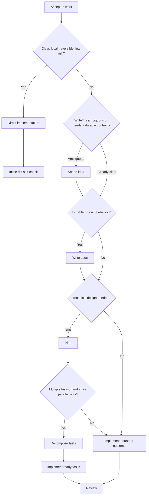
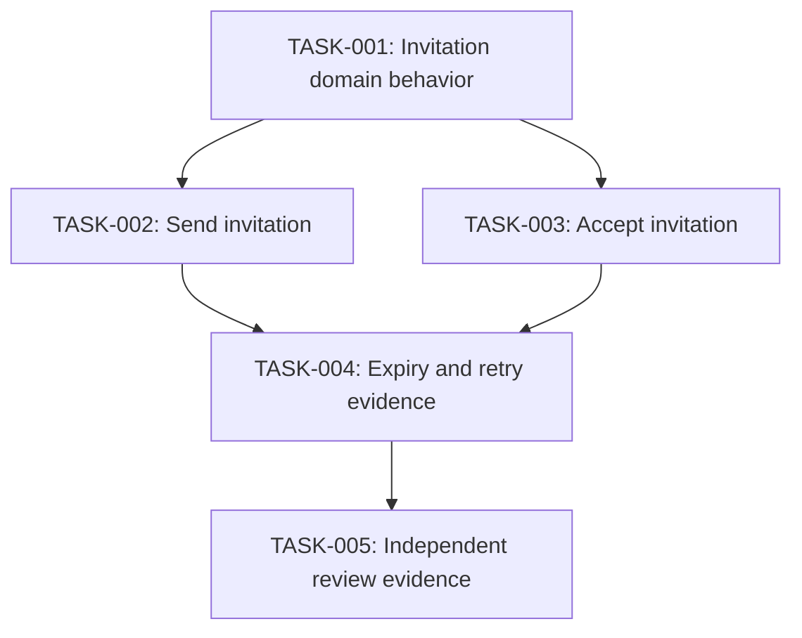
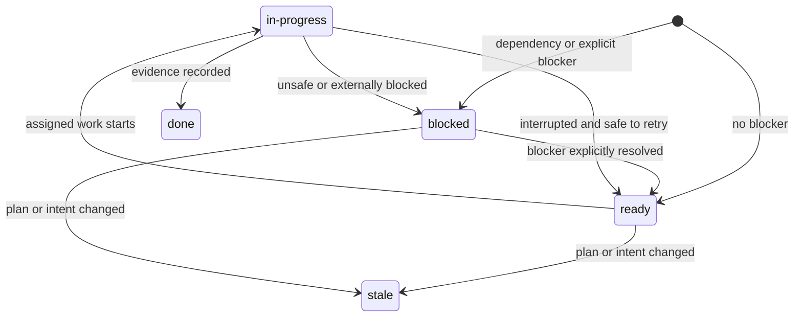
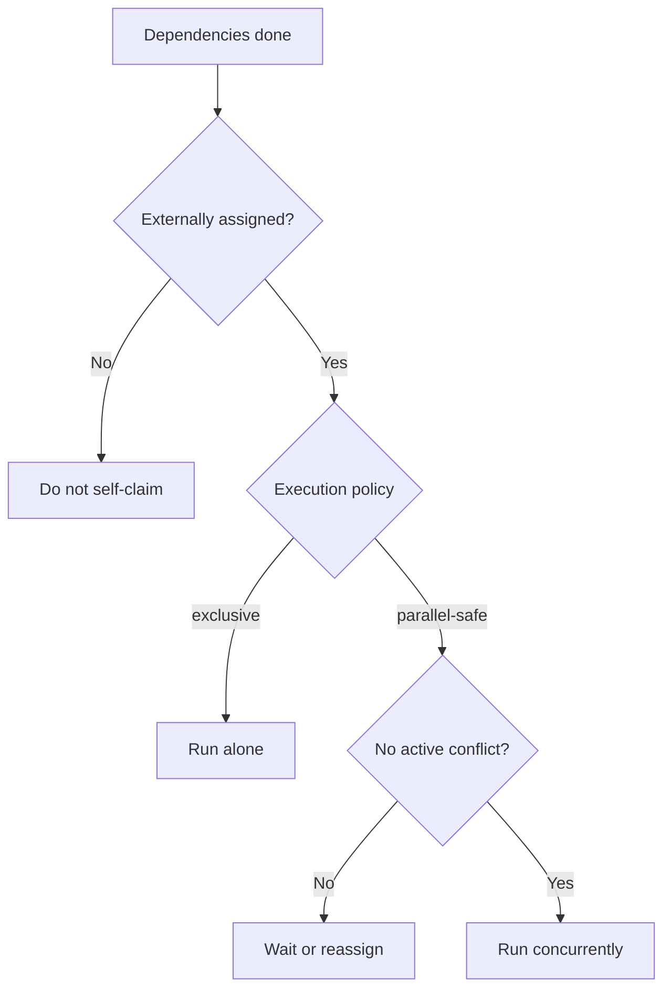
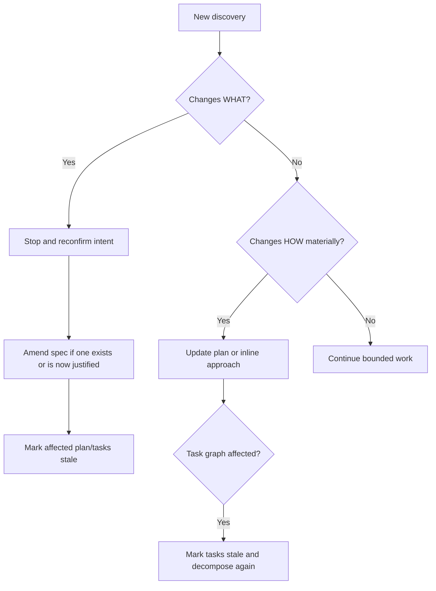

# Agentic SDLC Kit: Developer Guide

This guide explains how to develop software with Agentic SDLC Kit using any
compatible coding agent, including Codex, Claude Code, Cursor, GitHub Copilot,
or another tool that can read repository instructions and Agent Skills.

The kit is a decision and verification harness. It does not replace your coding
agent, programming language, test framework, issue tracker, or CI system.

## 1. The operating model

The full capability map is:

```text
idea -> shape-idea -> write-spec -> plan -> decompose-tasks -> implement -> review
```

This is not a mandatory pipeline. Each skill is a gate that you use only when
it adds value.



The governing rule is:

> Use the least durable process that safely preserves intent, evidence, and
> recoverability.

## 2. Install the kit

Clone Agentic SDLC Kit and run the installer from the kit directory:

```bash
python3 scripts/install.py /path/to/your/repository --dry-run
python3 scripts/install.py /path/to/your/repository
```

The target must be the root of an existing Git repository.

The installer adds:

```text
your-repository/
├── AGENTS.md
└── .agents/
    └── skills/
        ├── shape-idea/
        ├── write-spec/
        ├── plan/
        ├── decompose-tasks/
        ├── implement/
        ├── review/
        └── create-skill/
```

If your repository already has `AGENTS.md`, the installer preserves it and asks
for a manual semantic merge. Do not blindly replace repository-specific
commands or conventions.

## 3. Prepare the coding agent

Before starting work, ensure the coding agent can:

1. Read the repository-level `AGENTS.md`.
2. Discover skills under `.agents/skills/`.
3. Inspect files and Git diffs.
4. Run the repository's build, lint, test, and static-analysis commands.

Skill discovery locations differ between products. The canonical skill source
remains `.agents/skills/`; configure your tool to use that location if it does
not discover it automatically.

Start a new session with:

```text
Read AGENTS.md and the relevant repository guidance. Do not modify files yet.
Tell me which workflow gate is appropriate for this request and why:

<your request>
```

The agent should select the least expensive safe route. It should not create a
spec merely because code will change.

## 4. Choose the correct route

### Direct path

Use the direct path only when all of these are true:

- the accepted intent is unambiguous;
- the outcome is local and focused;
- the change is readily reversible;
- the risk is low;
- it fits one focused session;
- it introduces no new business rule or public contract;
- it does not change persistent-data semantics;
- it does not affect a trust boundary, permissions, payments, or privacy;
- it is not destructive and does not have difficult rollback;
- it is not an unclassified dependency or supply-chain change.

Artifacts created: none.

Evidence chain:

```text
accepted intent -> diff -> checks
```

### Spec-only path

Use a spec when the **what** needs to remain durable, but the **how** is
repository-standard and requires no material technical decision.

Artifacts:

```text
specs/<NNN-capability>/spec.md
```

Evidence chain:

```text
spec and requirements -> diff -> review evidence
```

### Plan-only path

Use a plan without manufacturing a spec when accepted intent already exists in
an issue, contract, reproduced behavior, or confirmed request, but the
technical approach needs durable decisions.

Artifacts:

```text
.work/<feature>/plan.md
```

Evidence chain:

```text
accepted intent -> plan -> diff -> review evidence
```

### Full path

Use the full path for new or ambiguous product behavior with non-obvious
technical design and multiple executable tasks.

Artifacts:

```text
specs/<NNN-capability>/spec.md
.work/<feature>/plan.md
.work/<feature>/tasks.md
.work/<feature>/handoff.md   # only when recovery or continuation is needed
```

Evidence chain:

```text
spec/intent -> plan -> tasks -> implementation -> review evidence
```

### Controlled path

Medium- or high-risk work always requires:

- a durable source of accepted intent;
- an approved plan;
- proportionate regression and failure-path evidence.

High-risk work additionally requires:

- rollback or recovery evidence when applicable;
- independent review from a fresh agent or session.

Risk overrides apparent change size.

## 5. Example A: direct typo fix

Request:

```text
Change the dashboard button label from "Creat report" to "Create report".
```

Prompt:

```text
Use implement. Treat this as a direct-path change only if it satisfies every
direct-path condition in AGENTS.md. State Intent, Change, and Verification
inline, inspect the relevant code, make the smallest change, run proportionate
checks, and self-check the final diff. Do not create a spec, plan, or tasks.
```

Expected agent preamble:

```text
Intent: Correct the visible dashboard label without changing behavior.
Change: Update the single label at its existing source.
Verification: Confirm the old text is absent from the affected surface, run the
relevant narrow check, and inspect the final diff for unrelated changes.
```

Expected behavior:

1. Locate the label.
2. Confirm it is not generated or translated elsewhere.
3. Edit only the relevant source.
4. Run the narrowest useful check.
5. Inspect the final diff.
6. Report the actual result.

Do not invoke a standalone review unless repository policy requires it or the
user asks for it.

## 6. Example B: bug fix without a new spec

Request:

```text
Invoice totals are doubled when the same line item is retried. The existing
behavior and failing regression test are authoritative.
```

This may use a direct path only if investigation confirms it remains local,
low-risk, and readily reversible. Otherwise use a plan-only path.

Prompt:

```text
Inspect the reported invoice regression and determine the minimum safe route.
Use the reproduced prior behavior and regression test as authoritative intent;
do not manufacture a product spec. If the fix is direct-path eligible, use
implement. If the technical correction has material data, compatibility, or
failure-handling decisions, use plan first and ask one material question at a
time.
```

If planning is needed, the plan can lead directly to one bounded
implementation outcome:

```text
Use implement for the single decision-complete outcome in the approved plan.
Do not create tasks.md unless multiple independently executable tasks, handoff,
or parallel execution would add value.
```

## 7. Example C: spec-only product behavior

Suppose the product owner has approved this behavior:

```text
Users can mute non-critical workspace notifications for a selected period.
Critical security notifications must always be delivered.
```

The product rule is durable, but implementation follows an established
notification policy pattern.

### Step 1: write the spec

```text
Use write-spec to persist the approved notification-muting behavior. Keep the
spec focused on observable product behavior, business rules, edge cases, and
acceptance criteria. Do not include framework, endpoint, table, or class
design. Decide whether this is one cohesive capability or requires multiple
specs, and ask before splitting if the boundary affects delivery.
```

Expected artifact:

```text
specs/012-notification-muting/spec.md
```

Example requirement:

```markdown
### REQ-001: Temporary notification muting

A user can mute non-critical workspace notifications until a selected expiry
time.
```

### Step 2: implement without a plan

```text
Use implement for the one bounded, decision-complete outcome in
specs/012-notification-muting/spec.md. The repository already has an accepted
notification-policy pattern, so do not create a plan or task graph unless
inspection reveals a material technical decision. Verify every relevant
requirement and record actual results.
```

The spec may move directly:

```text
approved -> implemented
```

### Step 3: review

```text
Use review against the fixed comparison base and
specs/012-notification-muting/spec.md. Review the actual committed and
uncommitted diff, execute relevant checks, map each requirement to evidence,
and return approved, changes-required, or blocked. Do not modify files.
```

After an approving evidence-based review:

```text
implemented -> verified
```

## 8. Example D: plan-only compatibility change

Accepted issue:

```text
The public client must continue accepting v1 payloads while services migrate to
v2. No user-visible behavior should otherwise change.
```

The intent is clear, but compatibility and rollout need design.

### Step 1: plan

```text
Use plan for issue #184. Treat the issue as authoritative intent; do not create
a product spec. Inspect current payload parsing, clients, tests, deployment
order, and compatibility conventions. Resolve one material technical decision
at a time with alternatives and a recommendation. Write an approved plan only
after I confirm the complete direction.
```

Expected artifact:

```text
.work/v2-payload-compatibility/plan.md
```

The plan should record:

- source intent;
- repository findings;
- confirmed decisions;
- design;
- source coverage;
- verification strategy;
- risk and rationale;
- rollout and recovery where applicable.

### Step 2: implement one outcome

If the approved design is one coherent change:

```text
Use implement for the single bounded outcome in the approved compatibility
plan. Do not manufacture tasks.md. Run the plan's regression and compatibility
checks and record exact observed results.
```

If implementation reveals multiple independent outcomes, stop and use
`decompose-tasks`.

## 9. Example E: full feature workflow

Feature:

```text
Workspace administrators can invite members by email, invitations expire after
seven days, and accepted invitations assign the selected workspace role.
```

### Step 1: shape the idea

```text
Use shape-idea to develop the workspace invitation feature. Ask one
high-impact question at a time, offer distinct alternatives when useful, mark
one as Recommended, and write no files. Continue until only non-material
uncertainty remains, then present the shared understanding for approval.
```

Example question:

```text
Who may invite a new member?

A. Workspace owners only — simplest authorization model.
B. Owners and administrators (Recommended) — matches the stated administrator
workflow while preserving a privileged boundary.
C. Any existing member — lowest friction but broadest abuse surface.

You can also provide another policy.
```

The human answers one decision at a time. The agent eventually presents:

```text
Problem
Desired outcome
Users and scenarios
In scope
Out of scope
Constraints
Acceptance signals
Confirmed decisions
Assumptions
Remaining questions: None
```

### Step 2: write capability specs

```text
Use write-spec to persist the approved workspace invitation understanding.
Choose one cohesive spec or propose multiple capability specs if they can be
accepted and released independently. Split by product capability, never by
frontend, backend, API, or database.
```

Possible result:

```text
specs/
├── README.md
└── 021-workspace-invitations/
    └── spec.md
```

### Step 3: create the technical plan

```text
Use plan for specs/021-workspace-invitations/spec.md. Inspect the repository
before recommending architecture. Ask one material technical question at a
time with clear alternatives and a recommended option. Cover authorization,
token lifecycle, data ownership, email integration, failure behavior,
observability, rollout, recovery, and verification only where relevant.
```

Expected artifact:

```text
.work/workspace-invitations/plan.md
```

The plan remains `draft` until the human confirms the complete technical
direction. It then becomes `approved`.

### Step 4: decompose the plan

```text
Use decompose-tasks for the approved workspace invitation plan. Create atomic
vertical tasks, link them to source requirements, identify dependencies,
blockers, change surfaces, symmetric conflicts, execution policy, acceptance
evidence, and exact validation commands or procedures. Do not redesign the
plan.
```

Example graph:



Example task:

```markdown
### TASK-003: Accept a valid invitation

- Plan: PLAN-021
- Source items: REQ-003, REQ-004
- Type: feature
- Risk: high
- Risk rationale: Assigns workspace authorization from an external token.
- State: blocked
- Depends on: TASK-001
- Blocker: TASK-001
- Execution: exclusive
- Change surface: invitation service, membership policy, integration tests
- Conflicts with: none
- Acceptance evidence: A valid unexpired invitation creates exactly one
  membership with the invited role.
- Validation commands/procedure: Run the invitation acceptance integration
  suite and verify replay, expiry, and authorization cases.
- Result: pending
```

### Step 5: implement ready tasks

```text
Use implement for TASK-001 in
.work/workspace-invitations/tasks.md. Re-read the authoritative task state,
confirm its dependencies and blocker, inspect affected code and tests, and
complete only this task. Persist exact validation results before marking it
done. Recompute dependent readiness afterward.
```

Continue one ready task at a time.

### Step 6: review

For high-risk work, use a fresh session or agent:

```text
Use review for the workspace invitation implementation. You did not implement
this change. Fix the base and head scope, inspect committed and uncommitted
changes, use the originating spec and plan as authoritative intent, execute
relevant checks, and review authorization, token lifecycle, replay, expiry,
leakage, rate limits, recovery, and requirement coverage where applicable. Do
not modify files.
```

An approving high-risk review must be independent.

## 10. Task states and execution



Rules:

- Only a `ready` task may enter `in-progress`.
- Every dependency must be `done` first.
- Dependency blockers may clear when dependencies complete.
- Decision, safety, and external blockers require explicit resolution.
- A failing or unrun required check cannot support `done`.
- A design change affecting task boundaries, dependencies, validation, or
  change surfaces makes affected tasks `stale`.

## 11. Parallel work

`Depends on` defines topology. `Execution` defines concurrency safety.



Markdown task state is not an atomic lock. Two agents must not independently
read the same `ready` task and both claim it. A human or external orchestrator
must assign parallel work before agents start.

`parallel-safe` means safe to schedule concurrently after assignment. It is not
permission for autonomous self-claiming.

## 12. Handoff and recovery

Create `.work/<feature>/handoff.md` whenever:

- work stops unfinished;
- another session or agent will continue;
- an interruption leaves recovery decisions;
- the working tree contains relevant unfinished changes.

The handoff records:

- baseline and working-tree state;
- current task and authoritative state;
- changes made;
- exact validation and results;
- decisions and deviations;
- risks and blockers;
- next eligible tasks.

`tasks.md` remains the source of task state. `handoff.md` is only a recovery
snapshot.

Resume with:

```text
Read AGENTS.md, the authoritative source artifacts,
.work/<feature>/tasks.md, and .work/<feature>/handoff.md. Treat tasks.md as
authoritative. Inspect the actual Git state and validation evidence before
trusting the handoff. Tell me the next eligible task and any discrepancy before
editing.
```

## 13. Change control

During implementation:



Never treat a discovery as silent permission to expand scope.

## 14. Review evidence

Review must distinguish:

- observed evidence;
- source-based inference;
- unverified claims.

Verdicts:

| Verdict | Meaning |
| --- | --- |
| `approved` | No unresolved finding requires an implementation change |
| `changes-required` | One or more findings must be corrected |
| `blocked` | Required evidence, access, scope, or independence is missing |

An `approved` verdict also requires:

- no unresolved acceptance failure;
- all risk-required evidence;
- independent review for high-risk work.

## 15. Common mistakes

### Creating a spec for every change

Wrong:

```text
Typo -> shape -> spec -> plan -> tasks -> implement -> review
```

Correct:

```text
Typo -> implement with inline verification and diff self-check
```

### Skipping a plan because the diff looks small

A one-line authorization or destructive-data change may be high risk. Route by
ambiguity, durability, coordination, reversibility, and risk—not line count.

### Splitting specs by technical layer

Do not create separate frontend, backend, database, and API specs for one
capability. Specs describe cohesive product behavior.

### Creating a one-node task graph

An approved spec or plan with one bounded outcome can go directly to
`implement`.

### Treating `parallel-safe` as a lock

Task Markdown cannot atomically claim work. Assign tasks externally before
parallel agents start.

### Marking a task done because code was written

`done` requires actual recorded evidence. Planned commands or unverified claims
are insufficient.

### Letting implementation rewrite intent

If **what** changes, stop and reconfirm. If **how** changes materially, update
the plan and invalidate affected tasks.

## 16. Prompt cheat sheet

| Need | Prompt |
| --- | --- |
| Select a route | `Recommend the least durable safe gate; do not edit.` |
| Shape an idea | `Use shape-idea; ask one material question at a time.` |
| Store behavior | `Use write-spec; keep implementation choices out.` |
| Design implementation | `Use plan; inspect the repository before deciding.` |
| Build task graph | `Use decompose-tasks; do not redesign the plan.` |
| Direct change | `Use implement; state Intent, Change, and Verification.` |
| Planned outcome | `Implement the one bounded artifact-backed outcome.` |
| Ready task | `Implement TASK-<ID>; record results before done.` |
| Review | `Review the fixed scope and intent; do not edit.` |
| Resume | `Reconcile tasks, handoff, and Git state before editing.` |

## 17. Definition of done

Work is complete only when:

- accepted scope is implemented;
- acceptance outcomes are demonstrably satisfied;
- relevant tests and static checks pass;
- security and failure behavior received proportionate consideration;
- the diff contains no unexplained unrelated changes;
- affected documentation and contracts are current;
- skipped checks, residual risks, and follow-up work are explicit.

Never accept “it should work” as completion evidence.
